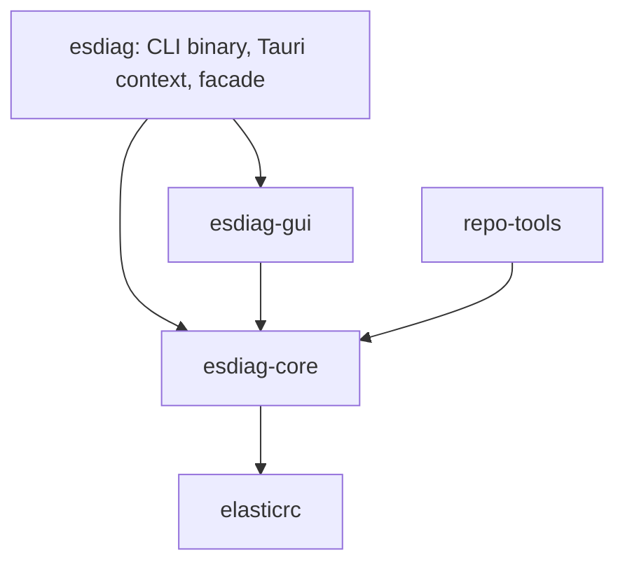

Repository Organization
=======================

This document explains the high-level layout of the repository so contributors can quickly find the right area before making changes.

Top-Level Layout
----------------

```text
.
├── .agents/
├── .github/
├── .gitignore
├── assets/
├── bin/
├── crates/
├── desktop/
├── docker/
├── docs/
├── openspec/
├── plugin/
├── src/
└── tests/
```

- `.agents/`: Shared agent skills for the repository.
- `.github/`: GitHub automation such as Actions workflows and issue templates.
- `.gitignore`: Root ignore rules for generated files, local artifacts, and other untracked content that should not be committed.
- `assets/`: Elastic Stack assets installed into target environments, such as configuration and setup content used by `esdiag setup`.
- `bin/`: User-facing helpers including standalone `esdiag-local`, repository build wrapper `esdiag-control`, and `esdiag-lite.sh`.
- `crates/`: Workspace packages: the `esdiag-core` and `esdiag-gui` implementation crates, the published `elasticrc` library, and unpublished `repo-tools` maintainer utilities.
- `desktop/`: Tauri desktop app root, including desktop config, capabilities, icons, packaging assets, and desktop-only build scripts.
- `gen/`: Generated Tauri schema output at the repo root during desktop builds; this directory is build output and is not tracked.
- `docker/`: Container and Compose definitions for local and packaging-related workflows.
- `docs/`: User-facing and maintainer-facing documentation.
- `openspec/`: OpenSpec change proposals, archived changes, and repository specification artifacts.
- `plugin/`: Distributable script-free Agent Skill package with thin Claude Code and Codex manifests. Its bundled `SKILL.md` and `references/` under `plugin/skills/` are generated from `.agents/skills/esdiag/` by `bin/sync-plugin-skill.sh` and must not be edited directly. The repository-root `.claude-plugin/marketplace.json` publishes the Claude package; Codex and OpenCode discover the canonical `.agents/skills/` copy in a checkout, while `esdiag setup skills` installs the matching embedded skill for binary users.
- `src/`: The `esdiag` binary: CLI entrypoint, `esdiag-local` container commands, and the facade library.
- `tests/`: Integration-style tests, CLI tests, runtime tests, and test fixtures.

Workspace Crates
----------------



- Root `esdiag` package: the CLI binary, Tauri context generation and bundle configuration (`tauri.conf.json`, `desktop/`), and a facade `src/lib.rs` that re-exports both implementation crates under the `esdiag::` paths used by `main.rs` and `tests/`. New library code belongs in the implementation crates.
- `crates/esdiag-core/`: Collection, processing, export, setup, and configuration. It never depends on `esdiag-gui`.
- `crates/esdiag-gui/`: The web server, its templates, and the Tauri desktop wrapper. Only the root package depends on it, behind the `server` feature.
- `crates/elasticrc/`: Published library for reading and resolving Elastic CLI context configuration.
- `crates/repo-tools/`: Unpublished binaries used only for repository maintenance. Run them with `cargo run -p repo-tools --bin <tool>`.

`esdiag-core` and `esdiag-gui` are published to crates.io with every `esdiag` release at the same version, so `cargo install esdiag` works; they have no supported public API. The files they embed stay in their canonical locations (`assets/`, `.agents/skills/esdiag/`, `docs/`). Each crate's build script reads them there in a checkout, and from a gitignored `bundled/` copy, written by `bin/sync-crate-assets.sh`, when packaged.

`bin/build-timings.sh` measures incremental debug builds for server, core, CLI, test, and clean scenarios on the current host.

`esdiag-core` Layout
--------------------

```text
crates/esdiag-core/src/
├── agent/
├── client/
├── data/
├── exporter/
├── job/
├── processor/
├── receiver/
├── setup/
├── cli_output.rs
├── elastic_upload_service.rs
├── embeds.rs
├── env.rs
├── es_mock.rs
├── lib.rs
├── onboarding.rs
└── system_integration.rs
```

### Directories

- `client/`: HTTP client implementations for Elastic Stack products such as Elasticsearch, Kibana, and Logstash.
- `data/`: Shared domain types, configuration models, known host handling, keystore support, settings, and workflow data structures.
- `exporter/`: Output adapters that write processed data to Elasticsearch, files, directories, archives, or stdout.
- `job/`: Saved job execution and management helpers.
- `processor/`: Diagnostic collection and transformation pipeline that turns raw inputs into normalized reports and exported documents.
- `receiver/`: Input adapters that read diagnostics from local archives,
  directories, remote services, and Elastic Upload Service links.
- `setup/`: `esdiag setup` logic: Elasticsearch and Kibana asset installation and license checks, the env and `.elasticrc` context sources, agent skill installation, and shell completions.

### Root Files

- `lib.rs`: Module declarations and `TestEnv`, which the `test-support` feature exposes to other crates' tests.
- `elastic_upload_service.rs`: Elastic Upload Service adapter used by the
  generic Send stage.
- `onboarding.rs`: Flow-neutral first-run configuration, persistence, and readiness operations shared by terminal and GUI flows.
- `env.rs`: Environment-variable defaults and lookup helpers.
- `embeds.rs`: Embedded setup assets, the ESDiag skill, and the Kibana assets bundle.
- `es_mock.rs`: Test-only Elasticsearch mock, also included by `tests/common/`.

`esdiag-gui` Layout
-------------------

- `src/server/`: Axum-based HTTP server and web UI runtime for archive
  submissions, settings, docs, Advanced page, and related browser-facing
  features, including its static assets in `src/server/assets/`.
- `templates/`: Askama HTML templates that power the web UI.
- `src/desktop.rs`: Tauri desktop wrapper that starts the embedded server and opens it in a window (`desktop` feature).
- `src/embeds.rs`: Embedded documentation and server frontend assets.
