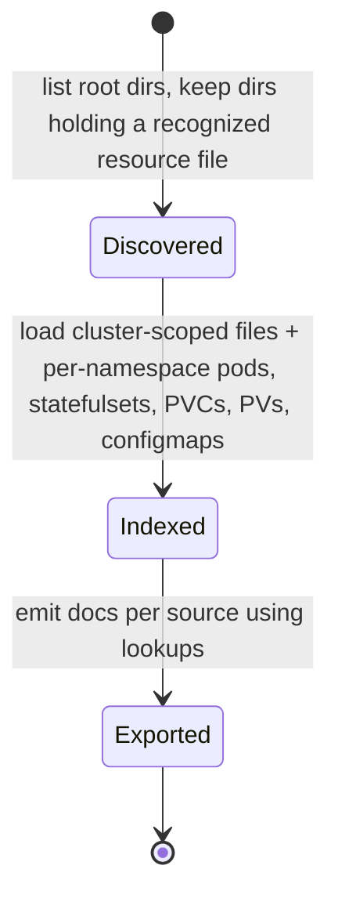

## Context

`eck-diagnostics` produces a zip with one root folder:

```text
manifest.json                  diagType, diagVersion, collectionDate, includedDiagnostics[]
version.json                   DiagnosticsVersion + Kubernetes ServerVersion
eck-diagnostics.log            tool run log (parameters, "ECK version is …")
eck-diagnostic-errors.txt      collection errors (Go slice printed as text)
nodes.json                     cluster-scoped kubectl List objects
storageclasses.json
podsecuritypolicies.json
clusterroles.txt, clusterrolebindings.txt
<namespace>/                   one per operator/resource namespace
  pods.json, statefulsets.json, persistentvolumeclaims.json, persistentvolumes.json,
  events.json, configmaps.json, secrets.json (metadata only, `Items` key),
  services.json, endpoints.json, deployments.json, replicasets.json,
  controllerrevisions.json, daemonsets.json, serviceaccount.json, networkpolicies.json,
  elasticsearch.json, kibana.json, agent.json, logstash.json, beat.json,
  apmserver.json, enterprisesearch.json, elasticmapsserver.json   (ECK CR lists)
  pod/<pod>/logs.txt           container logs for every pod in the namespace
  elasticsearch/<name>/…       included Stack diagnostics (already processed as children)
  kibana/<name>/…
```

Every `*.json` resource file is a `kubectl get -o json` `List` (`apiVersion`, `kind`,
`items`, `metadata`); empty lists are 84-byte files. `persistentvolumes.json` is
cluster-wide even though it is written per namespace. In the reference bundle (not
committed) the ECK-level files total under 3 MB while pod logs total ~95 MB and the two
included Stack diagnostics ~90 MB.

Current state: `ElasticCloudKubernetesDiagnostic::process` is a no-op that warns;
included children fan out through the generic `Processor` after the parent finishes
(children get `diagnostic.parent_id` = parent `diagnostic.id` and inherit `platform: ECK`). Kibana links are
hardcoded to the Elasticsearch Cluster Report. Existing Kubernetes dashboards group
Elasticsearch nodes by the `node.attributes.k8s_node_name` node attribute.

Constraints: ADR-0019 (platform bundles are `Load`-only; the `sources.yml` registry
describes API sources only), ADR-0013 (source-aligned field shapes), ADR-0015 (stream
naming contract with drift test), ADR-0016 (outcome from recorded events), no Python,
no external binaries.

## Goals / Non-Goals

**Goals:**

- Index the ECK files that answer the escalation questions in the proposal, with
  each file either processed, used only to enrich another document, or skipped for a
  documented reason.
- Make ECK platform documents joinable to the included Elasticsearch child and to the
  existing Kubernetes dashboards.
- Guarantee by construction that credentials and user payloads in the bundle are not
  indexed.
- Ship one dashboard that makes the new streams immediately useful.

**Non-Goals:**

- Stack pod logs (`pod/<non-operator>/logs.txt`). They are the bulk of the bundle,
  duplicate log data the application diagnostics are better placed to own, and Kibana
  and Logstash logs here are plain text rather than JSON. A future log-processing
  change can add them.
- Enriching included child documents (for example adding the Kubernetes node or zone
  to `metrics-node-esdiag`). Children are separate jobs; joining at query time on
  pod name / `k8s_node_name` avoids coupling processors.
- KubernetesPlatform (MKI) processing. The `kubernetes.*` stream names are chosen so
  it can reuse them later, but that processor is unchanged.
- Triggering ECK bundle generation (ADR-0019 "delegated acquisition").

## File inventory

Legend: ✅ processed into a stream · 🔗 enrichment/metadata only · ❌ not read.

| File | Use | Stream / rationale |
| --- | --- | --- |
| `manifest.json` | 🔗 | Existing manifest/fan-out |
| `version.json` | 🔗 | Kubernetes + tool version → operator doc |
| `eck-diagnostics.log` | 🔗 | ECK version, operator/resource namespaces → operator doc |
| `eck-diagnostic-errors.txt` | 🔗 | Collection errors → operator doc |
| `<ns>/configmaps.json` | 🔗 | Only `elastic-operator` `eck.yaml` and `elastic-licensing` → operator doc; all other ConfigMaps hold user pipelines, scripts, or Helm release blobs |
| `<ns>/{elasticsearch,kibana,agent,logstash,beat,apmserver,enterprisesearch,elasticmapsserver}.json` | ✅ | `settings-eck.resource-esdiag` |
| `<ns>/elasticsearch.json` `spec.nodeSets` | ✅ | `settings-eck.nodeset-esdiag` |
| `<ns>/statefulsets.json` | 🔗 | Rollout state → nodeSet doc; operator image tag fallback |
| `<ns>/pod/<operator-pod>/logs.txt` | ✅ | `logs-eck.operator-esdiag` |
| `nodes.json` | ✅ | `metrics-kubernetes.node-esdiag` |
| `<ns>/pods.json` | ✅ | `metrics-kubernetes.pod-esdiag`, `metrics-kubernetes.container-esdiag`; per-node request sums |
| `<ns>/persistentvolumeclaims.json` | ✅ | `metrics-kubernetes.volume-esdiag` |
| `<ns>/persistentvolumes.json`, `storageclasses.json` | 🔗 | Joined into volume docs |
| `<ns>/events.json` | ✅ | `logs-kubernetes.event-esdiag` (high signal, but events expire after ~1h so often sparse) |
| `<ns>/pod/<other-pod>/logs.txt` | ❌ | Non-goal (see above) |
| `<ns>/elasticsearch/*`, `<ns>/kibana/*` | ❌ | Processed as included children |
| `<ns>/secrets.json` | ❌ | Metadata only; no diagnostic value; security |
| `<ns>/controllerrevisions.json` | ❌ | StatefulSet template history; large; revision drift already captured via StatefulSet status |
| `<ns>/deployments.json`, `replicasets.json` | ❌ | Kibana/Agent/APM availability already in CR status and pod docs |
| `<ns>/services.json`, `endpoints.json` | ❌ | Endpoint readiness duplicates pod readiness |
| `<ns>/daemonsets.json` | ❌ | ECK does not manage DaemonSets except Beats/Agent, whose pods are covered |
| `<ns>/serviceaccount.json`, `clusterroles.txt`, `clusterrolebindings.txt` | ❌ | RBAC failures surface as operator log errors; text dumps |
| `<ns>/networkpolicies.json`, `podsecuritypolicies.json` | ❌ | Rarely populated (PSP removed in Kubernetes 1.25); low triage value |

This table ships as `src/processor/elastic_cloud_kubernetes/diagnostic.md`, following
the Logstash precedent.

## Data stream catalog

| Stream | Grain | Key fields (beyond `diagnostic.*`, `kubernetes.*` join keys) | Diagnoses |
| --- | --- | --- | --- |
| `settings-eck.operator-esdiag` | 1 per bundle | `eck.version`, `eck.diagnostics.version`, `kubernetes.version.{git_version,major,minor}`, `eck.operator.namespaces`, `eck.resources.namespaces`, `eck.operator.config.*`, `eck.license.{level,enterprise_resource_units,total_managed_memory_bytes,timestamp}`, `eck.diagnostics.errors` | Version support matrix, licensing/ERU, operator config (namespaces watched, webhook), incomplete collection |
| `settings-eck.resource-esdiag` | 1 per ECK CR | `eck.resource.{kind,name}`, `spec.version`, `metadata.generation`, `status.*`, `generation_lag` | Unhealthy/stuck resources, failed associations, operator lag |
| `settings-eck.nodeset-esdiag` | 1 per ES nodeSet | `elasticsearch.name`, `nodeset.{name,count,roles}`, `resources.{requests,limits}.{cpu,memory}`, `jvm.heap.{min,max}_bytes`, `volume_claims[].{name,storage_bytes,storage_class}`, `statefulset.{replicas,ready_replicas,updated_replicas}`, `rollout_in_progress` | Sizing, heap/memory ratio, stuck rolling upgrades |
| `logs-eck.operator-esdiag` | 1 per JSON log line | `@timestamp`, `log.level`, `log.logger`, `message`, `iteration`, `took`, `error`, `eck.resource.{kind,name}` | Reconcile errors timeline, slow reconciles per resource |
| `metrics-kubernetes.node-esdiag` | 1 per k8s node | `capacity.*`, `allocatable.*`, `conditions[]`, `taints[]`, `unschedulable`, `zone`, `roles`, `node_info.*`, `scheduled.{pods,requests.*,limits.*}` | Node pressure, overcommit, zone spread, version skew |
| `metrics-kubernetes.pod-esdiag` | 1 per pod | `status.{phase,qos_class,start_time}`, `conditions[]`, `eck.resource.{kind,name}`, `eck.type`, `elasticsearch.roles[]`, `restart_count`, `not_ready_containers` | Pending/unready pods, placement, restarts |
| `metrics-kubernetes.container-esdiag` | 1 per container status | `container.{name,init,image_tag,ready,started,restart_count}`, `state.{current,reason}`, `last_terminated.{reason,exit_code,finished_at}`, `resources.*` | OOMKilled, crash loops, missing limits |
| `metrics-kubernetes.volume-esdiag` | 1 per PVC | `claim.{name,phase,access_modes,storage_class}`, `requested_bytes`, `capacity_bytes`, `conditions[]`, `volume.{reclaim_policy,csi_driver}`, `storage_class.{provisioner,allow_volume_expansion,volume_binding_mode}` | Pending resizes, non-expandable classes, `Delete` reclaim risk |
| `logs-kubernetes.event-esdiag` | 1 per event | `type`, `reason`, `message`, `count`, `first_timestamp`, `last_timestamp`, `source.component`, `involved_object.{kind,name,namespace}` | FailedScheduling, probe failures, FailedMount, evictions |

Documents use the existing envelope. `@timestamp` is the diagnostic collection date,
except event and operator-log documents, which use their own timestamps (so their
panels show the pre-collection timeline).

## Decisions

### 1. Stream names: `eck.*` for operator-owned data, `kubernetes.*` for core resources

Pods, nodes, volumes, and events are generic Kubernetes objects; CRs, nodeSets,
licensing, and operator logs are ECK-specific. Using `kubernetes.*` for the former lets
a future KubernetesPlatform processor write the same streams (distinguished by
`diagnostic.platform`) without renames, which matters because stream names are a
contract spanning processor, templates, and dashboards (ADR-0015). The alternative, all
`eck.*`, is simpler today but would force a second set of streams and dashboards for
MKI. Following the Logstash precedent (`settings-logstash.node-esdiag`), the product
goes in the subtype position and the object in `.sub`.

### 2. File table in the ECK module, not `sources.yml`

ADR-0019 says the collection registry only describes API sources for the three
API-collectable products. ECK sources are fixed bundle paths with a scope. The module
declares a const table of `EckSource { key, file, scope: Cluster | Namespaced, stream }`
entries, and dispatch iterates it (the same table shape as `LS_DISPATCH`). A unit test
asserts every stream in the table has an index template (the global drift test covers
this too) and every non-❌ inventory row has an entry.
*Alternative*: an `assets/eck/sources.yml` without URLs. Rejected: it would stretch the
registry's meaning, and ECK has no version-gated URLs, weights, or collect semantics.

### 3. Minimal typed serde structs as the allowlist

Each source deserializes into hand-written structs containing only allowlisted fields
(unknown fields are ignored by serde), so env vars, annotations, `managedFields`, and
ConfigMap/Secret data never reach a document. Labels deserialize to a map and are
filtered by an Elastic-owned key predicate before output. ConfigMaps deserialize
`metadata.name` plus `data` only for the two allowlisted names (a custom `Deserialize`
that skips `data` otherwise).
*Alternative*: the `k8s-openapi` crate. Rejected: it is heavy, feature-gated per
Kubernetes version, and deserializes every field, so the allowlist would be a second
filtering step that is easy to bypass.

### 4. Processing typestate inside the ECK processor

The outer `Processor<Ready → Processing → Completed | Failed>` lifecycle is unchanged.
Inside `process`, the ECK bundle moves through explicit states:



- `EckBundle<Discovered>`: `namespaces: Vec<String>`, root file presence.
- `EckBundle<Indexed>`: immutable `EckLookups` — nodes by name, storage classes by
  name, PVs by name, pod→node, per-node request sums, PVC→mounting pod,
  StatefulSet by name, operator pods, operator metadata (versions, license, config).
- `Exported`: per-source `ProcessorSummary`s sent on `summary_tx`.

Transitions are consuming methods (`discover(receiver) -> Result<EckBundle<Discovered>>`,
`index(self) -> Result<EckBundle<Indexed>>`, `export(self, exporter, summary_tx)`), so a
source cannot be exported before its lookups exist. Lookups are built once; all
enrichment reads from them. Pods are the largest input (~1.4 MB for 16 pods); a pod list
is deserialized once per namespace and reused for pod, container, and node-sum output.

### 5. Trait boundaries

- **Receiver** (no new variant): add `Receiver::list_bundle_dirs(&self, dir: &str) -> Result<Vec<String>>`
  and `Receiver::read_bundle_lines(&self, path: &str) -> Result<BoxStream<'static, Result<String>>>`
  for `ArchiveBytes`, `ArchiveFile`, and `Directory`; other variants return an error,
  mirroring `read_bundle_json`. The archive implementation streams the zip entry through
  a buffered line reader on a blocking task.
- **Processor**: `ElasticCloudKubernetesDiagnostic` keeps `DiagnosticProcessor`;
  documents implement the existing `DocumentExporter<EckLookups, EckMetadata>` trait so
  batching, summaries, and failure events are shared with other processors.
- **Exporter**: `Exporter::kibana_link` gains a `KibanaLinkTarget` argument
  (`ClusterReport | EckPlatform`) holding the dashboard origin id and data view id; the
  resolver looks up the requested pair. The report builder picks `EckPlatform` when
  `platform == ECK && application.is_none()`.

### 6. Namespace discovery from the bundle, not the log

Namespaces are root directories that contain a recognized namespaced resource file.
`eck-diagnostics.log` is free-form text (a Go `%+v` struct), so parsing it is used only
to populate `eck.operator.namespaces` / `eck.resources.namespaces` in the operator doc,
with failure leaving them unset. Included diagnostic paths from the manifest are
excluded from reading because the processor only reads known file names at a namespace
root and the operator's `pod/<pod>/logs.txt`.

### 7. Quantity parsing in-house

A small `quantity` module parses Kubernetes quantities to `f64` (cores or bytes) with
the suffix set in the spec. It is a dozen lines and avoids a dependency; failures
return `None` and omit the field.

### 8. Operator log shape

ECK logs are ECS JSON lines with a resource-specific name key (`es_name`, `kb_name`,
`agent_name`, `logstash_name`, `beat_name`, `apm_name`, `ent_name`, `ems_name`;
`kibana_name` and `ls_name` are also accepted). `took` is seconds as a float and
`iteration` a string. `logs.txt` is wrapped in non-JSON `==== START/END logs ====` lines. The processor
maps the present key to `eck.resource.{kind,name}` and keeps the ECS keys as-is
(ADR-0013). Non-JSON lines (panic output, klog prefixes) are counted, not indexed.
Operator pods are those labeled `control-plane: elastic-operator` in any collected
namespace.

### 9. Collection errors are data, not outcome

`eck-diagnostic-errors.txt` reports what the ECK tool failed to collect (commonly the
removed PSP API or missing credentials). It is stored on the operator doc and does not
record report events, because the ESDiag processing of the bundle did not fail;
recording it would mark most healthy bundles Partial.

### 10. Templates

- `esdiag@eck-metadata`: `diagnostic` and `event` (same as `esdiag@ls-metadata`) plus
  `kubernetes.{namespace,pod.name,node.name}` keywords and `eck.resource.{kind,name}`.
- `esdiag@eck-mappings`: explicit numeric types for quantity/byte/count fields and
  `message` as `match_only_text` with a keyword subfield.
- Nine index templates `metrics-kubernetes.node.json`, … composed of
  `esdiag@eck-mappings`, `esdiag@eck-metadata`, `esdiag@settings`, each with the
  matching `data_stream.type` constant, following `settings-logstash.json`.

### 11. Dashboard

"ECK Platform Overview" panels:

1. Summary metrics: ECK version, Kubernetes version, license level, ERUs, managed memory.
2. Resource health table: kind, name, version, health, phase, available/expected, generation lag.
3. NodeSet sizing table: count, roles, CPU/memory limits, heap, storage, rollout in progress.
4. Pods not Running/Ready, and top containers by restarts with last terminated reason.
5. Kubernetes nodes: pressure conditions, allocatable vs scheduled requests, Elastic pods per node and per zone.
6. Volumes: requested vs provisioned, resize pending, non-expandable class, `Delete` reclaim policy.
7. Warning events table.
8. Operator log: errors over time by resource; `took` percentiles by resource kind.

## Risks / Trade-offs

- [Events expire after ~1h, so bundles are often sparse] → Keep the panel and state the
  retention limit in its description; do not treat absence as healthy.
- [`scheduled.*` node sums only cover collected namespaces] → Name the fields
  `scheduled` (not `allocated`) and state the lower-bound meaning in the template
  `_meta` and dashboard panel description.
- [Bundle format drift across `eck-diagnostics` versions (e.g. `secrets.json` uses
  `Items`)] → All struct fields `Option`, unknown fields ignored, missing files tolerated;
  fixtures cover empty lists and absent files.
- [Large clusters with thousands of pods] → One deserialization per namespace, lookups
  hold only small derived maps; operator logs are streamed. Pod lists are not streamed;
  revisit if memory becomes a problem.
- [Private data in test fixtures] → The fixture is a hand-authored synthetic bundle with
  fictional names; no file from a customer bundle is copied or committed.
- [ES pod name ≠ ES node name if users override `node.name`] → ECK sets `node.name` to
  the pod name; overrides are unsupported by ECK, so accept the rare mismatch.

## Migration Plan

Additive. `esdiag setup` installs the new templates and dashboard; existing indices
are untouched. Rollback is reverting the release; the new streams can be deleted
independently.

## Open Questions

- Should a later change enrich child `metrics-node-esdiag` docs with the Kubernetes
  node and zone once parent lookups exist, instead of relying on the
  `k8s_node_name` attribute users must configure?
- Should Stack pod logs be processed in a follow-up log-ingestion change, and scoped by
  level (WARN+) to bound volume?
