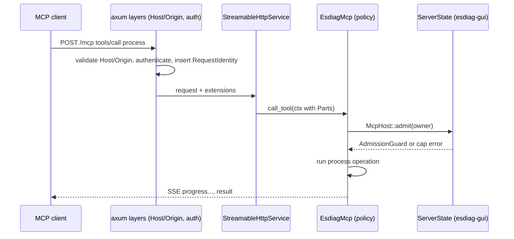

## Context

See proposal.md for motivation. Current state that shapes the approach, assuming `extract-gui-crate` (#467), `extract-command-operations`, and `add-mcp-stdio` have merged:

- `esdiag-gui` is outside the workspace `default-members`, so its tests run only with `cargo test --workspace` or `-p esdiag-gui`. It depends on `esdiag-core` with `features = ["server"]`, and its feature forwarding uses `esdiag-gui?/…` from the root.
- Server handlers that need a keystore password for a job wrap the work in `with_scoped_keystore_password`. The server never calls `enable_keystore_password_prompt()`, so secret lookups never prompt.

- `esdiag-core::mcp` provides `EsdiagMcp`, an rmcp `ServerHandler` built from an `McpPolicy`; `McpPolicy::Local` offers the full catalog. `esdiag mcp` serves it over stdio from the root binary.
- The web server is in `esdiag-gui` (`crates/esdiag-gui/src/server/`). `Server::start` builds one axum `Router`, then applies `require_authenticated_user` (when `ServerPolicy::requires_authentication()`), a 512 MiB body limit, and client-hint headers as layers over all routes.
- `ServerPolicy` composes runtime mode, authentication provider, identity header, web features, and job caps. Web feature parsing fails startup for unknown names and for `job-builder` without `keystore`.
- Service-mode admission is `ServerState::record_job_started(owner)`, which returns `JobAdmissionError::{GlobalCapReached, OwnerCapReached}` against `active_jobs_by_owner`. Its counterpart releases the slot when the job ends.
- Service-mode web processing accepts Elastic Upload Service links (`service_link`) and file uploads, and exports to the startup exporter.
- rmcp 3.11 `StreamableHttpService` is a tower service. It inserts the request's `http::request::Parts`, including axum extensions set by earlier middleware, into each MCP request's `RequestContext::extensions`. Its config validates `Host` against loopback by default (`allowed_hosts`) and `Origin` when `allowed_origins` is non-empty. `legacy_session_mode: false` serves requests statelessly. With `json_response: true` it answers in JSON unless the handler emits notifications first, in which case it switches to server-sent events (SSE). Protocol version `2026-07-28` removes sessions (SEP-2567).

## Goals / Non-Goals

**Goals:**

- Reuse the `add-mcp-stdio` catalog unchanged in `user` mode.
- Keep the service-mode safety envelope a function of runtime mode, never of MCP or authentication configuration.

**Non-Goals:**

- MCP OAuth authorization (protected resource metadata, token validation). Access control stays with the existing authentication providers.
- Advertising or registering the desktop app's ephemeral-port server for MCP clients.
- File upload through MCP. Service-mode inputs are Elastic Upload Service links, which already carry the bundle.
- New receivers, processors, exporters, or typestate stages.

## Decisions

### Service-mode policy in core, admission and identity from the GUI

`McpPolicy` gains `Service { host: Arc<dyn McpHost> }`. `McpHost` is a trait defined in `esdiag-core::mcp` and implemented by `esdiag-gui`:

- `identity(&RequestContext) -> Identity` reads the `RequestIdentity` extension that the authentication layer inserted; the anonymous default when the provider is `none`.
- `admit(&self, owner) -> Result<AdmissionGuard, JobAdmissionError>` wraps `record_job_started`, and the guard's `Drop` releases the slot.
- `exporter() -> Exporter` returns the startup exporter.

`McpPolicy::Local` also uses `McpHost` in `user` mode from the GUI, so that identity reaches `Identifiers` and active-job stats update; its `admit` never rejects. The stdio binary uses a no-op local host. `JobAdmissionError` and the `RequestIdentity` type move to `esdiag-core` if the operations refactor has not already moved them.

Service policy lists only `process`, with a separate parameter struct (`input` only). It validates `input` with the existing `Uri` resolution and accepts only `Uri::ElasticUploadService` variants. It passes the host exporter instead of resolving one.

Alternatives considered:

- Implement service-mode tools in `esdiag-gui`. Rejected: it duplicates tool schemas and result conversion and splits the catalog across crates.
- Admission inside the operation. Rejected: CLI and stdio have no caps, and caps are service-mode policy owned by the server.

### One router, MCP inside the authentication layer

`/mcp` is a `nest_service("/mcp", StreamableHttpService::new(...))` added to the same router before the authentication layer, so it inherits `require_authenticated_user` and the body limit. A `mcp_host_guard` layer scoped to `/mcp` performs the `Host` and `Origin` checks. rmcp's own checks are configured with the same list, so a misconfiguration cannot open one path without the other.

The `require_authenticated_user` middleware inserts `RequestIdentity` into request extensions. If it does not already do this, the change adds it; other handlers keep their current extractors.

### Stateless, JSON when possible

`StreamableHttpServerConfig { legacy_session_mode: false, json_response: true, cancellation_token: <server shutdown token>, allowed_hosts, allowed_origins, .. }`. Statelessness lets service-mode replicas run without session affinity and needs no session expiry. Progress notifications switch a response to SSE. Server shutdown cancels the token, which ends in-flight streams.

Cancellation over stateless HTTP is the client closing the stream. rmcp drops the handler future, which the stdio design already treats as cancellation.

Alternative considered: stateful sessions (`LocalSessionManager`). Rejected: sessions are removed in protocol `2026-07-28`, they need affinity behind a load balancer, and no tool needs per-session state.

### Allowed hosts

`--mcp-allowed-hosts`, then `ESDIAG_MCP_ALLOWED_HOSTS`, then `localhost,127.0.0.1,::1`. Allowed origins are derived as `http://` and `https://` origins for each allowed host. Entries without a port match any port. A bind address other than loopback, combined with default allowed hosts, logs a warning at startup that remote clients will be rejected.

### Feature and policy wiring

| Root feature | Enables |
|---|---|
| `mcp` | `esdiag-core/mcp`, `esdiag-gui?/mcp`, root `rmcp` (`transport-io`) |

`esdiag-gui/mcp` enables `esdiag-core/mcp` and `rmcp` with `transport-streamable-http-server`. `WebFeature::Mcp` is always parseable. `ServerPolicy` rejects it at startup without `esdiag-gui/mcp`, mirroring `job-builder` without `keystore`. `ServerPolicy::allows_mcp()` gates the route. Service mode does not strip `mcp` the way it strips local-artifact features, because the service policy, not route omission, enforces the envelope.

## Risks / Trade-offs

- [Agents automate submissions to the shared service] → Per-owner and global caps apply. The deferred output-cluster load budget in `web-runtime-modes` names rising automation as its trigger, and this change is such a trigger. Revisit that budget when MCP traffic appears in service-mode metrics.
- [`none` authentication in service mode exposes `process` to anyone who can reach the port] → Same exposure as the existing upload-service web flow. `mcp` is opt-in, and the `Host` allowlist blocks DNS rebinding.
- [Desktop user-mode server enables `mcp` through `ESDIAG_WEB_FEATURES`] → The tools reach the same local configuration the desktop UI already edits, on loopback with host validation. There is no registration path, so this is not advertised.
- [Clients on protocol versions earlier than `2026-07-28` expect a session ID] → Streamable HTTP allows servers that issue no session ID. Verify with Claude Code and Codex HTTP clients in the verification task.

## Migration Plan

Additive and opt-in. Existing deployments are unchanged until `mcp` is added to their web features. Rollback is removing `mcp` from `ESDIAG_WEB_FEATURES`.
