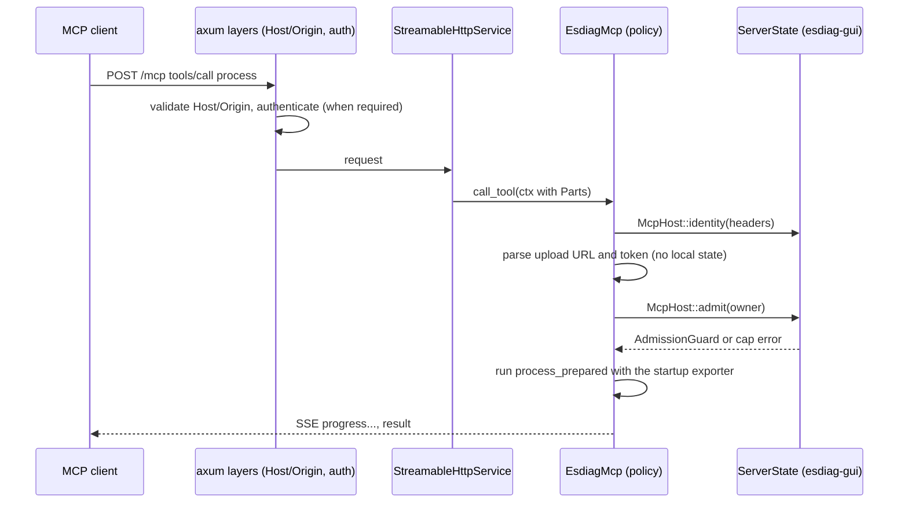

## Context

See proposal.md for motivation. Current state that shapes the approach, assuming `extract-gui-crate`, `extract-command-operations`, and `add-mcp-stdio` have merged:

- `esdiag-gui` is outside the workspace `default-members`, so its tests run only with `cargo test --workspace` or `-p esdiag-gui`. It depends on `esdiag-core` with `features = ["server"]`, and its feature forwarding uses `esdiag-gui?/…` from the root.
- Server handlers that need a keystore password for a job wrap the work in `with_scoped_keystore_password`. The server never calls `enable_keystore_password_prompt()`, so secret lookups never prompt.

- `esdiag-core::mcp` provides `EsdiagMcp`, an rmcp `ServerHandler` built from an `McpPolicy`; `McpPolicy::Local` offers the full catalog. `esdiag mcp` serves it over stdio from the root binary.
- The web server is in `esdiag-gui` (`crates/esdiag-gui/src/server/`). `Server::start` builds one axum `Router`, then applies `require_authenticated_user` (when `ServerPolicy::requires_authentication()`), a 512 MiB body limit, and client-hint headers as layers over all routes.
- `ServerPolicy` composes runtime mode, authentication provider, identity header, web features, and job caps. Web feature parsing fails startup for unknown names and for `job-builder` without `keystore`.
- Service-mode admission is `ServerState::record_job_started(owner)`, which returns `JobAdmissionError::{GlobalCapReached, OwnerCapReached}` against `active_jobs_by_owner`. Its counterpart releases the slot when the job ends.
- Service-mode web processing accepts Elastic Upload Service links (`service_link`) and file uploads, and exports to the startup exporter. The `service_link` handler takes the download URL and its token as separate fields, sets the token as the URL's `token:` userinfo, and runs `execute_synchronous_processing`, which binds the startup exporter into the caller's `ExecutionContext`.
- `Uri::try_from` is not side-effect free: it first parses the input as a saved-host reference and resolves it, which reads `hosts.yml` and can read the keystore, and it checks filesystem metadata for path inputs. Upload links become `Uri::ServiceLink` (with a `token:` password) or `Uri::ServiceLinkNoAuth`; the receiver accepts only `ServiceLink`.
- `UploadServiceDownloader::download_bytes` runs a `reqwest::blocking::Client` request inside `block_in_place`, so dropping its future cannot interrupt a download in progress.
- `ServerState::resolve_identity(headers)` resolves the request identity for every provider: the identity header for `google-iap`, and `ESDIAG_USER`/`ESDIAG_ACCOUNT` (plus `esdiag.yml` in `user` mode only) for `none`. `require_authenticated_user` is mounted only when the policy requires authentication, and it inserts nothing into request extensions.
- The desktop app starts its ephemeral-port server through `Server::start` in `user` mode with no web feature override, so `ESDIAG_WEB_FEATURES` reaches it.
- `operations::process::process` takes a `ProcessInput`, resolves local input and output defaults, and creates its own `ExecutionContext`.
- rmcp 3.11 `StreamableHttpService` is a tower service. It inserts the request's `http::request::Parts`, including axum extensions set by earlier middleware, into each MCP request's `RequestContext::extensions`. Its config validates `Host` against loopback by default (`allowed_hosts`) and `Origin` when `allowed_origins` is non-empty. `legacy_session_mode: false` serves requests statelessly. With `json_response: true` it answers in JSON unless the handler emits notifications first, in which case it switches to server-sent events (SSE). Protocol version `2026-07-28` removes sessions (SEP-2567).

## Goals / Non-Goals

**Goals:**

- Reuse the `add-mcp-stdio` catalog unchanged in `user` mode.
- Keep the service-mode safety envelope a function of runtime mode, never of MCP or authentication configuration.

**Non-Goals:**

- MCP OAuth authorization (protected resource metadata, token validation). Access control stays with the existing authentication providers.
- Advertising or registering the desktop app's ephemeral-port server for MCP clients.
- File upload through MCP. Service-mode inputs are Elastic Upload Service links, which already carry the bundle.
- New receivers, processors, exporters, or typestate stages.

## Decisions

### Service-mode policy in core, admission and identity from the GUI

`McpPolicy` gains `Service { host: Arc<dyn McpHost> }`. `McpHost` is a trait defined in `esdiag-core::mcp` and implemented by `esdiag-gui`:

- `identity(&http::HeaderMap) -> Result<RequestIdentity>` calls `ServerState::resolve_identity` on the headers from the request's `Parts`, for every request and every provider, so provider `none` keeps the configured `ESDIAG_USER`/`ESDIAG_ACCOUNT` that web jobs use. It inherits that function's service-mode rule of never reading `esdiag.yml`. Identity does not depend on the authentication layer, which is absent for provider `none`. A resolution error fails the call before admission.
- `admit(&self, owner) -> Result<AdmissionGuard, JobAdmissionError>` wraps `record_job_started`, and the guard's `Drop` releases the slot.
- `exporter() -> Exporter` returns the startup exporter.

`McpPolicy::Local` also uses `McpHost` in `user` mode from the GUI, so that identity reaches `Identifiers` and active-job stats update; its `admit` never rejects. The stdio binary uses a no-op local host. `JobAdmissionError` and the `RequestIdentity` type move to `esdiag-core` if the operations refactor has not already moved them.

Service policy lists only `process`, with a separate parameter struct: `url` and `token`, both required.

- `url` goes through `UploadLink::parse`, a new upload-only parser in `esdiag-core` that never calls `Uri::try_from`, `HostReference`, or the filesystem. It accepts only an absolute `https` URL whose host is `upload.elastic.co`, with no userinfo, query, or fragment, and a non-empty path. Anything else, including saved-host names, archive paths, and directories, fails with `invalid_input` before any I/O. Bare upload identifiers are not accepted, because no verified mapping from an identifier to a download URL exists.
- `token` is the per-upload download token, the same value the web `service_link` form takes. It is the one credential a tool parameter may carry, and only in service mode, where no keystore or terminal exists to supply it. The exception is acceptable because download tokens are temporary: each grants access to one upload and expires shortly after it is issued. The parser sets it as the URL's `token:` userinfo and builds `Uri::ServiceLink` directly. The token is never echoed in results or failures, logged, persisted, or accepted inside `url`. The `user`-mode catalog keeps rejecting download tokens, as in `add-mcp-stdio`.
- The tool calls a new core entry point, `operations::process::process_prepared(input, exporter, identifiers, context) -> ExecutionOutcome`. It takes an already-built `Input`, the host exporter to bind into the caller's `ExecutionContext`, the request's `Identifiers`, and the context that carries the MCP progress observer and request ownership. It resolves no local defaults and does not inspect the input kind. Service-mode MCP passes the `Input` built from the validated `ServiceLink`. `esdiag-gui`'s `execute_synchronous_processing` becomes a thin wrapper over it, so both of its callers keep working unchanged: the `service_link` route and the API-key collection route, which passes `Input::CollectBinding`. Each keeps building its own HTTP result, including parent and included-diagnostic results, from the returned `ExecutionOutcome`.

Alternatives considered:

- Implement service-mode tools in `esdiag-gui`. Rejected: it duplicates tool schemas and result conversion and splits the catalog across crates.
- Admission inside the operation. Rejected: CLI and stdio have no caps, and caps are service-mode policy owned by the server.

### One router, MCP inside the authentication layer

`/mcp` is a `nest_service("/mcp", StreamableHttpService::new(...))` added to the same router before the authentication layer, so it inherits `require_authenticated_user` and the body limit. A `mcp_host_guard` layer scoped to `/mcp` performs the `Host` and `Origin` checks. rmcp's own checks are configured with the same list, so a misconfiguration cannot open one path without the other.

The authentication layer only rejects; it does not carry identity. Tools resolve identity from the request headers through `McpHost::identity`, as described above.

### Stateless, JSON when possible

`StreamableHttpServerConfig { legacy_session_mode: false, json_response: true, cancellation_token: <server shutdown token>, allowed_hosts, allowed_origins, .. }`. Statelessness lets service-mode replicas run without session affinity and needs no session expiry. Progress notifications switch a response to SSE. Server shutdown cancels the token, which ends in-flight streams.

Cancellation over stateless HTTP is the client closing the stream, or server shutdown cancelling the token. rmcp drops the handler future, which the stdio design already treats as cancellation. Dropping the future only stops work that runs inside it or is aborted with it:

- The Upload Service download becomes a request on the async (non-blocking) `reqwest::Client`, awaited inside the operation future. It replaces today's `reqwest::blocking::Client` call inside `block_in_place`. Dropping the future aborts the request. Today `ServiceLink` is downloaded in three places: the async `resolve_stable_load` when the bundle is materialized, the synchronous `Receiver::try_from_with_scrub` otherwise, and therefore the CLI's `operations::process::process`, which constructs its receiver eagerly through `try_from_with_scrub` before the job runs. A synchronous constructor cannot await.
- The fix is one async constructor, `Receiver::prepare(uri, scrubbed, filename_hint).await`. For `ServiceLink` it downloads the bytes with the async downloader and builds the `ArchiveBytesReceiver`, applying the same filename detection and scrub handling as today. For every other `Uri` it delegates to `try_from_with_scrub`. `try_from_with_scrub` rejects a bare `ServiceLink` with an error naming `Receiver::prepare`, so no caller can reach a blocking download.
- The three callers move to it. `resolve_stable_load` uses the async downloader for both branches. The CLI's `process` awaits `Receiver::prepare` in place of `try_from_with_scrub` and keeps the rest of its preparation unchanged: `--sources` detection and `init_sources` from the prepared receiver, `Identifiers` from `receiver.filename()`, and the input binding. The web `service_link` route and MCP reach the download through the resolver. All of them share one cancellable download.
- Export work is not all inside the future. Document consumers run under `AbortOnDropHandle` (`add-mcp-stdio`), but `ElasticsearchExporter::batch_tx` spawns a detached task per batch, and that task runs every sub-batch of `batch_send` once its permit is acquired. Aborting the consumer neither reaches those tasks nor waits for anything to end, because an abort is only a request.
- Each execution therefore gets an execution-scoped `TaskTracker` and `CancellationToken` (from `tokio-util`) carried by its `ExecutionContext`. The exporter spawns batch tasks through the tracker instead of bare `tokio::spawn`, and `batch_send` checks the token before each sub-batch, so a cancelled export sends no further sub-batches. `send_value_batch` waits out both of its retry backoffs, after a request rejected with HTTP 429 and before resending only the documents Elasticsearch rejected with 429, in a `tokio::select!` against the token, and checks it before every resend, so cancellation during backoff returns at once without another request. A cancelled sub-batch ends through `finish_after_failure` with a cancellation error, the same path as a failed resend: documents already created still count, documents awaiting a resend count as failed, and the error makes `batch_send` record the remaining sub-batches as unsent and stop. A request already on the wire runs to completion or its timeout.
- The `AdmissionGuard` is owned by the operation future, not by the transport or handler wrapper. `Drop` cannot wait, so dropping the guard does not release the slot directly. It cancels the token, closes the tracker, and spawns a task that awaits `TaskTracker::wait()` and only then releases the slot. A cancelled call cannot free its slot while its download or any export task is still running. A call that completes normally releases the slot after the tracker is empty too, so both paths share one release point.

Tests cover a client disconnect and a server shutdown during two phases, each against a local mock server: during a stalled download, and during a bulk export whose second sub-batch request stalls. In each case the call reports no success, the mock receives no request after cancellation besides the one in flight, and the owner's slot is free only after the in-flight request ends.

`StreamableHttpService` calls its service factory for every request, and `EsdiagMcp::new` creates a fresh `config_writes` lock. A factory that called `new` would give each concurrent request its own lock, so two `host_add` calls could each read `hosts.yml` and the later write would drop the earlier host. `/mcp` therefore builds one `EsdiagMcp` at server startup and the factory returns clones of it. `EsdiagMcp` derives `Clone`; a clone shares the `Arc` for `config_writes` and for the `McpHost`, and copies only the tool router. Every request in the process then serializes configuration writes through the same lock, as stdio does. Separate processes, such as `esdiag mcp` and `esdiag serve` running at once, still do not share it, the same as two CLI commands today.

Alternative considered: stateful sessions (`LocalSessionManager`). Rejected: sessions are removed in protocol `2026-07-28`, they need affinity behind a load balancer, and no tool needs per-session state.

### Allowed hosts

`--mcp-allowed-hosts`, then `ESDIAG_MCP_ALLOWED_HOSTS`, then `localhost,127.0.0.1,::1`. Allowed origins are derived as `http://` and `https://` origins for each allowed host. Entries without a port match any port. A bind address other than loopback, combined with default allowed hosts, logs a warning at startup that remote clients will be rejected.

### Feature and policy wiring

| Root feature | Enables |
|---|---|
| `mcp` | `esdiag-core/mcp`, `esdiag-gui?/mcp`, root `rmcp` (`transport-io`) |

`esdiag-gui` has no `server` feature; it is the server crate, and root `server` is what adds it as a dependency. Its new `mcp` feature enables `esdiag-core/mcp` and `rmcp` with `transport-streamable-http-server`. Because root `mcp` forwards it as `esdiag-gui?/mcp`, it takes effect only when root `server` is also enabled. `WebFeature::Mcp` is always parseable. `ServerPolicy` rejects it at startup without `esdiag-gui/mcp`, mirroring `job-builder` without `keystore`. `ServerPolicy::allows_mcp()` gates the route. Service mode does not strip `mcp` the way it strips local-artifact features, because the service policy, not route omission, enforces the envelope.

Cargo unifies features per package, so whenever `esdiag-gui/mcp` is in the build graph, the single `rmcp` that core also links has the HTTP transport enabled. The boundary is therefore about code, not compiled features: only `esdiag-gui` contains HTTP transport integration, and `esdiag-core` never names the transport. CI checks the compiled boundary in an isolated `cargo tree -p esdiag-core --features mcp` build, where no GUI dependency can enable it.

### Desktop never mounts `/mcp`

`ServerStartOptions` gains `mcp_endpoint: bool`, false by default. Only `esdiag serve` sets it. `Server::start`, which the desktop app uses, leaves it false. When it is false, `/mcp` is never mounted, whatever `ESDIAG_WEB_FEATURES` or the build features say. If `mcp` is in the web feature list anyway, `ServerPolicy` removes it with a warning that the MCP endpoint is not available in this host, before the build-support check runs, and startup continues. A desktop build without the `mcp` feature therefore also starts, so a shell profile shared with `esdiag serve` cannot break the desktop app. The build-support startup error applies only when `mcp_endpoint` is true, that is, to `esdiag serve`.

## Risks / Trade-offs

- [Agents automate submissions to the shared service] → Per-owner and global caps apply. The deferred output-cluster load budget in `web-runtime-modes` names rising automation as its trigger, and this change is such a trigger. Revisit that budget when MCP traffic appears in service-mode metrics.
- [`none` authentication in service mode exposes `process` to anyone who can reach the port] → Same exposure as the existing upload-service web flow. `mcp` is opt-in, and the `Host` allowlist blocks DNS rebinding.
- [Desktop user-mode server inherits `ESDIAG_WEB_FEATURES=mcp`] → `mcp_endpoint` is false for desktop startup, so the route is never mounted there, and startup warns instead of failing.
- [Service-mode `process` takes a download token as a tool parameter] → It is the same per-upload token the web `service_link` form already accepts. It is scoped to one upload and expires after a short time, so a leaked token exposes far less than a password or API key, and it is the only credential service mode can obtain. It is never echoed, logged, persisted, or accepted embedded in a URL, and the `user`-mode catalog still rejects tokens.
- [Clients on protocol versions earlier than `2026-07-28` expect a session ID] → Streamable HTTP allows servers that issue no session ID. Verify with Claude Code and Codex HTTP clients in the verification task.

## Migration Plan

Additive and opt-in. Existing deployments are unchanged until `mcp` is added to their web features. Rollback is removing `mcp` from `ESDIAG_WEB_FEATURES`.
