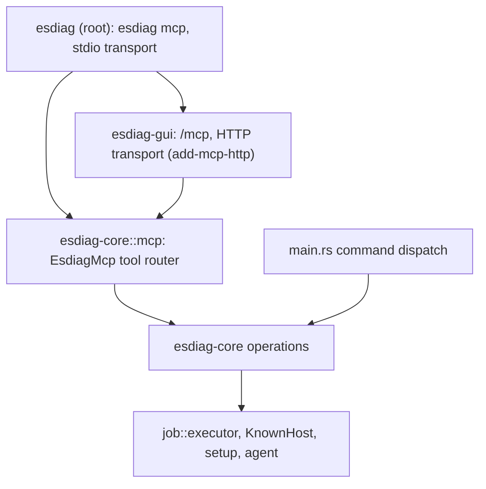

## Context

See proposal.md for motivation. Current state that shapes the approach, assuming the two prerequisites have merged:

- After `extract-gui-crate`, the library is `esdiag-core` (`crates/esdiag-core/`), the web server and Tauri wrapper are `esdiag-gui` (`crates/esdiag-gui/`), and the root `esdiag` package holds `main.rs`, `local.rs`, `local/`, and a facade library. Only the root package depends on `esdiag-gui`.
- After `extract-command-operations`, each finite command is a function in `esdiag-core::operations` that takes a `*Input` struct and returns `Result<CommandOutcome>` (`Completed(CliOutcome)` or `Streamed`) without printing, prompting, or reading `Cli`. `ProcessInput::writes_stdout()` reports stdout export before execution, and `job::job_run(name, StdoutPolicy)` checks a saved job's stdout export against the caller's policy on the same loaded copy it runs. `HostAddInput` and `HostUpdateInput` take a `KeystorePasswordSource`; the binary passes `get_password_for_secret_commands`, and the catalog passes `get_keystore_password`. `main.rs` keeps argument parsing, terminal prompts, tracing setup, and outcome rendering.
- `CliOutcome` and `CliFailure` (`cli_output`) are `Serialize` with a snake_case `result` or `category` discriminator, which is the structured-output contract in `cli-structured-output`.
- `collect`, `process`, and `job run` run through `job::executor::execute_with_context(job, context)`. `ExecutionContext` already carries an observer that receives `ExecutionEvent { identity, stage, lifecycle, message }` for start, progress, and completion of each stage.
- Keystore prompting is opt-in. `get_keystore_password` prompts only after the process calls `enable_keystore_password_prompt()`, which `async_main` does for foreground commands that don't log to the terminal. Otherwise it uses `ESDIAG_KEYSTORE_PASSWORD`, then the unlock lease, then fails. `esdiag serve` never enables it.
- `processor::init_sources` installs a process-wide `sources.yml` override.
- `exporter/stream.rs` writes processed documents to stdout for output `-` and for saved jobs whose process export is `Stdout`; `local.rs` prints in 19 places.
- The Elastic CLI extension profile (`validate_extension_profile`) admits only `collect`, `process`, `send`, `output`, `version`, `setup`, and `job`.

## Goals / Non-Goals

**Goals:**

- One tool catalog that both transports serve, so `add-mcp-http` adds a transport and a policy, not tools.
- Tools and CLI commands share an operation, so their behavior cannot drift.

**Non-Goals:**

- MCP resources, prompts, sampling, elicitation, and logging notifications.
- `local` lifecycle tools. `local.rs` stays in the root binary, outside the shared catalog, and prints to stdout.
- Offering `mcp` through the Elastic CLI extension profile.
- New receivers, processors, exporters, or typestate stages. Tools call existing operations; no trait boundary changes.

## Decisions

### Catalog in `esdiag-core`, transports at the edges



`esdiag-core` gains a `mcp` module behind an `mcp` feature, depending on `rmcp` with `server` and `macros`. It defines `EsdiagMcp`, a `ServerHandler` whose `#[tool_router]` methods map one-to-one to the catalog in `specs/mcp-tool-catalog/spec.md`. Each method deserializes a `schemars`-derived parameter struct, calls the shared operation, and converts `Result<CliOutcome>` into a `CallToolResult`.

The root package enables `rmcp/transport-io` and runs `EsdiagMcp::new(McpPolicy::Local).serve(rmcp::transport::stdio_pipes())`. `stdio_pipes` uses Tokio's non-blocking pipe driver on Linux when the client launches the server with FIFOs, and falls back to the blocking `stdio()` handles elsewhere. `esdiag-gui` adds the HTTP transport in `add-mcp-http`.

`McpPolicy` is the only extension point the HTTP change needs. It decides which tools are listed and constrains their parameters; `Local` offers the full catalog. `add-mcp-http` adds a service-mode policy.

Alternatives considered:

- Catalog in the root binary. Rejected: `esdiag-gui` cannot depend on the root package, so the HTTP transport would need a second catalog.
- A separate `esdiag-mcp` crate. Rejected for now: the catalog is a thin layer over `esdiag-core` operations, and `extract-gui-crate` holds further splits until its build timings are known. It can move later without changing the specs.

### Feature mapping

| Root feature | Enables |
|---|---|
| `mcp` | `esdiag-core/mcp`, `dep:rmcp` (root, `transport-io`) |
| `full` | adds `mcp` to `agent`, `server`, `setup`, `keystore`, `elasticrc` |

Per-tool gates reuse the existing `keystore`, `agent`, and `setup` features. `rmcp`'s `#[tool_router]` ignores `#[cfg]` on individual methods, so each gate is its own `#[cfg]`-gated `impl` block with a named router (`core_tools`, `job_tools`, `agent_tools`, `setup_tools`), and `EsdiagMcp::new` adds the compiled routers together. The listed tools follow the build.

`rmcp` 3.11 requires Rust 1.88; the workspace MSRV is 1.89.

### Results and failures

- Success: `CommandOutcome::Completed(outcome)` becomes `CallToolResult::structured(serde_json::to_value(outcome))`, which sets both `structuredContent` and one JSON text item. `Streamed` cannot occur, because tools reject stdout export before calling the operation.
- Operation failure: `CallToolResult::structured_error(...)` with the `CliFailure` from `cli_output::structured_failure`, which `extract-command-operations` moves into `esdiag-core`.
- Parameter failure: rmcp's `Parameters<T>` extractor fails before the method runs, and rmcp reports it as a tool result with `isError` and a "failed to deserialize parameters" text item, not as JSON-RPC `-32602`. This follows the MCP guidance that input validation errors are tool errors a model can correct. Parameter structs use `deny_unknown_fields`, so an unsupported argument such as `sources` fails the same way.

Two failures the substring classifier in `classify_failure` would misreport get typed errors that `structured_failure` downcasts: `operations::job::SavedJobStdoutRejected` maps to `invalid_input`, and `data::KeystoreLocked`, found anywhere in the error chain, maps to `keystore_failed` with a message directing the user to `esdiag keystore unlock`. The second also changes the CLI's JSON failure for a locked keystore, which previously took whichever category its wrapping context's wording matched.

Alternative considered: return only text YAML. Rejected: clients would have to parse YAML, which is the problem this change removes.

### Credentials and prompts

`async_main` skips `enable_keystore_password_prompt()` for `Commands::Mcp`, as it does for `serve`. Secret lookups inside operations then take the existing fail-closed path (environment variable, unlock lease, error), and the tool reports `keystore_failed`. This does not depend on the `is_terminal` checks, which a client that inherits a terminal could satisfy. The catalog does not offer the keystore mutation operations, which take an explicitly resolved password.

Host tool parameter structs have no `apikey`, `username`, or `password` fields; they build a `HostInput` with those fields `None` and only `secret` set.

### Stdout ownership

`esdiag mcp` initializes tracing with the stderr writer, as `serve` does, writes no `last_run/esdiag.log`, and is listed in `command_owns_stdout`. Its default level is `warn`; `LOG_LEVEL` or `--debug` raises it. The `process` tool rejects input where `ProcessInput::writes_stdout()` is true, and `job_run` calls `operations::job::job_run` with `StdoutPolicy::Reject`, which rejects a stdout-exporting job; both fail before running anything.

### Progress and cancellation

Operations build their own `ExecutionContext`, so the tool cannot pass one in without changing every operation signature. Instead, `job::context` holds a task-local `SCOPED_OBSERVER`, set with `with_scoped_observer`, that `ExecutionContext::default()` adopts in place of the no-op observer, following the `SCOPED_KEYSTORE_PASSWORD` pattern. When the request carries a progress token, each long-running tool runs its operation in that scope with an observer that queues `ExecutionEvent`s on a channel, and forwards them as `notifications/progress` through the request's `Peer`. The tool drains the channel before returning, so every notification precedes the result. Progress is a monotonic event counter, `total` is unset, and the message is `"<stage> <lifecycle>"` plus the event message. `send` does not run through the executor and reports its own start and completion.

rmcp cancels a request's cancellation token on `notifications/cancelled`; tools read it from the `RequestContext` extractor. The tool races the boxed operation future against it with `tokio::select!` and drops the operation on cancellation. Dropping the future stops collection and export loops at their next await point. Tasks the executor spawned may finish their current request; see Risks.

### Serialized configuration writes

`EsdiagMcp` holds a `tokio::sync::Mutex<()>` that `host_add`, `host_update`, `host_remove`, `job_delete`, `output_set`, `output_clear`, and `collect` and `process` with `save_job` lock for the whole call. The operations save the job inside their bodies, so locking around only the write would need another operation split; a saving collection therefore delays other configuration writes, but not reads or other runs. `hosts.yml`, `jobs.yml`, and settings are read-modify-write files without locking, and a stdio server is the first ESDiag process where two writes can overlap.

### `sources` excluded, `save_job` kept

`--sources` calls a process-wide `init_sources`, so a long-lived server would apply one call's override to every later call. It is omitted from tool schemas. `save_job` is an optional `collect` and `process` parameter, as on the CLI, because deriving a saved job needs the same arguments.

### Plugin registration

`plugin/.mcp.json`:

```json
{ "mcpServers": { "esdiag": { "command": "esdiag", "args": ["mcp"] } } }
```

Claude Code discovers `.mcp.json` at the plugin root. The Codex manifest references it from `plugin.json` (`"mcpServers": "./.mcp.json"`), the field Codex's `core-plugins` manifest parser reads. `bin/sync-plugin-skill.sh` drift checks do not cover `.mcp.json`, which is hand-maintained; `tests/plugin.sh` asserts its contents.

## Risks / Trade-offs

- [Cancellation leaves spawned work running] → Dropping the tool future stops the executor's own loops, but spawned bulk-export tasks finish their in-flight request. The spec requires only that no success is reported and the server keeps serving. A cancellation token threaded through the executor is future work if partial exports matter.
- [Operations refactor slips] → This change does not start until `extract-command-operations` merges. Implementing tools against `main.rs` would need a second copy of each command body.
- [Agents call `send` or `collect` without user intent] → Open-world and non-read-only annotations let hosts require confirmation. The skill's intent-driven collection rule still applies.
- [Concurrent `collect` calls write to the same output directory] → Archive names include a timestamp to the second. Two collections from the same application in the same second could collide, which is also true for two CLI processes today.
- [Codex plugin MCP field differs] → Validated against the Codex manifest parser. The Claude Code registration does not depend on it.

## Migration Plan

Additive. The release adds `esdiag mcp`. The only CLI output change is that a locked keystore always reports `keystore_failed` with the unlock message. Rollback is disabling `mcp` in `full` and removing `.mcp.json` from the plugin.
