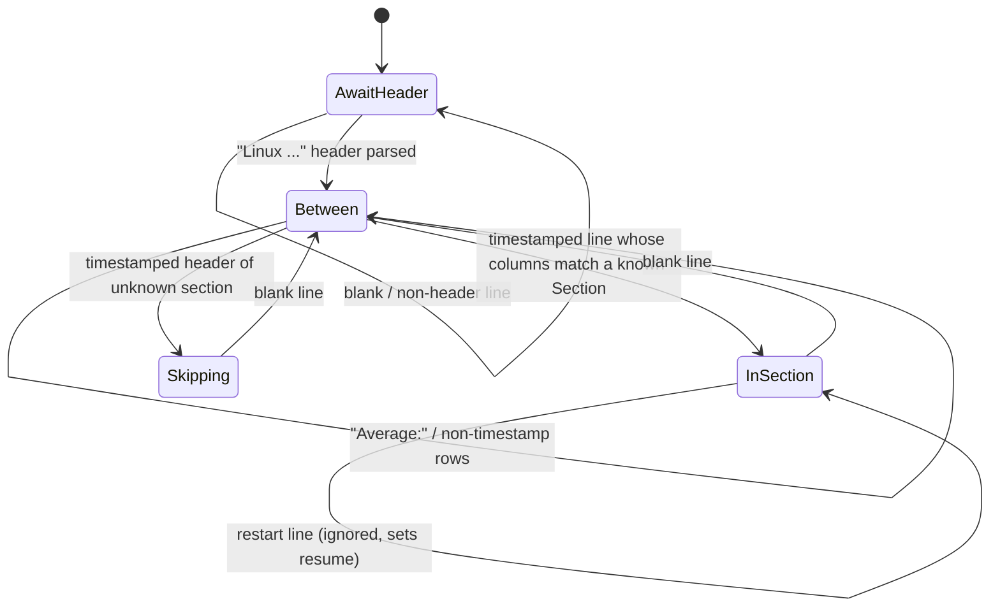

## Context

See `proposal.md` (Why) and `specs/host-sar-processing/spec.md` for the behavior contract.

Seams that already exist and are reused unchanged:
- **Line streaming**: `Receiver::is_bundle`, `Receiver::has_bundle_dir`, and `Receiver::read_bundle_lines(path)`. The last returns `BoxStream<Result<String>>`, decodes UTF-8 lossily, strips line endings, and works the same for archive-file, archive-bytes, and directory receivers. No new receiver trait is needed.
- **Platform**: `resolve_platform` returns `SelfManaged` when `syscalls/` exists and nothing more specific applies. SAR does not consult the platform (see Decision 1).
- **Nodes**: `Nodes` (`nodes/data.rs`) is parsed once in `ElasticsearchDiagnostic::try_new` and converted into `Lookups.node: Lookup<NodeDocument>`. `NodeDocument` drops `transport_address` and `http.publish_address`, which listening-socket correlation needs.
- **Export**: `exporter.document_channel::<Doc>(rx, data_stream, batch_size)` consumes an `mpsc` channel per stream, and `ProcessorSummary::merge` / `add_child` aggregates child streams. This is the pattern in `nodes_stats/processor.rs`.
- **Envelope**: `ElasticsearchMetadata::for_data_stream` stamps `@timestamp` with the collection date.
- **Reporting**: `DiagnosticReport::add_single_processor_summary` treats `source.missing` as neutral (no event), `parsed == false` as a processor failure, and otherwise records a success verdict.
- **Selection**: `ApiResolver::processing_defs` builds processing options only from `sources.yml` entries that carry a `required` marker. `resolve_processing_selection` rejects unknown keys, expands an empty list to the diagnostic-type defaults, and returns only the resolved list. `ProcessSelection { product, diagnostic_type, selected }` is persisted in saved jobs, and `ElasticsearchDiagnostic::should_process(key)` checks it (`None` = process everything). `validate_resolved_processing_selection` errors when a selected key was not collected. The web form leaves `job.process.selected` empty until the user changes a checkbox, then sends the full checked list.
- **Reconciliation**: the `source-reconciliation` spec forbids merging `diags.yml` command entries into the REST registry until a command-source model exists.
- **Templates**: `metrics-node.json` matches `metrics-node*-esdiag*` at priority 300. `metrics-host.sar-esdiag` falls outside every existing pattern. `esdiag@settings` leaves `index.mapping.total_fields.limit` at the default 1000 and sets `ignore_dynamic_beyond_limit: true`, so fields past the limit are silently left unindexed.

## Goals / Non-Goals

**Goals:**
- One streaming pass over `sar.txt`, keeping parsed records but never the whole text.
- Ingest every section, row, and column `sar -A` can emit. Unrecognized sections surface as report warnings, not silent drops.
- Host-scoped documents with correct multi-node correlation for self-managed, ECE-allocator, and ECK-node collections.
- No change to existing data streams, templates, or `node.*` enrichment.

**Non-Goals:**
- Decoding binary sysstat data files (`saDD`, `sarDD`). Their record layout changes across sysstat versions, and decoding would need either a sysstat-format decoder in Rust or a `sadf` binary, which breaks the self-contained constraint. The text output already carries the same samples.
- Parsing other `syscalls/*` files as metrics. `ss.txt`/`netstat.txt` are read only as correlation evidence.
- Collecting syscall output. Per-OS command definitions, reconciliation of the catalog against `diags.yml`, and ESDiag-run commands belong to a separate syscall collection change. The catalog shape (Decision 1) leaves room for them.
- Syscall processing for Kibana and Logstash bundles. The catalog's per-application `processors` list allows adding them later.
- Timezone inference or override.

## Decisions

### 1. Syscall catalog and dispatch, separate from `sources.yml`

A new embedded catalog, `assets/syscalls/sources.yml`, is application-neutral because `syscalls/` output describes the host, whichever application was diagnosed. It is keyed by `diags.yml` command keys and parsed into its own type, not the REST `Source`:

```yaml
sar:
  filename: "syscalls/sar.txt"
  tags: standard,support
  processable: true
  processing_weight: 3
  option: true            # user-facing processing option `syscalls.sar`
  processors: [elasticsearch]
ss:
  filename: "syscalls/ss.txt"
netstat:
  filename: "syscalls/netstat.txt"
```

- A `SyscallSource` struct with `filename`, `tags`, `processable`, `processing_weight`, `option`, and `processors`. Unknown fields are rejected, so a typo fails at load. The future collection change adds a per-OS `commands` map to these entries additively, mirroring `diags.yml` `linuxOS`/`macOS`/`winOS`. Keys and processing behavior do not change.
- Embedded with `include_str!`, like the REST registries. No `--sources`-style override in this change.
- `ss` and `netstat` are collect-only entries: SAR resolves their paths from the catalog, so no processor hard-codes `syscalls/…` strings.
- `SYSCALL_DISPATCH: &[SyscallEntry]` per application. In this change only Elasticsearch has one, with a single `sar` entry. `validate_syscall_registry(application)` mirrors `validate_processable_registry`: each processable entry listing that application has exactly one dispatch entry, and vice versa. It runs in the same `OnceLock` validation as `ES_DISPATCH`.
- `ElasticsearchDiagnostic::process` runs the syscall dispatch alongside `ES_DISPATCH` in the same concurrent set, weighted by `processing_weight`.

- *Rejected: a `sources.yml` entry.* `sources.yml` is the REST collection definition reconciled with `elastic-rest.yml` (ADR-0006), and the `source-reconciliation` spec forbids merging `diags.yml` commands into it. A bundle-only OS file with no `versions` also breaks `validate_es_dispatch_registry`.
- *Rejected: a one-off sibling task with a hard-coded path.* It can't be deselected, and each future syscall processor would reimplement the gating and missing-file policy.
- *Rejected: per-application syscall catalogs.* The same `syscalls/sar.txt` appears in Elasticsearch, Kibana, and Logstash support bundles. One catalog with a `processors` list avoids three copies of every path.
- *Rejected: gating on `Platform::SelfManaged`.* Allocator and Kubernetes-node runs produce `syscalls/`, but their bundles can resolve to another platform.

### 1a. Selection: `syscalls.<key>` options and explicit-request tracking

- `processing_defs(product)` appends one non-required `ProcessingOptionDef` per catalog entry with `option: true` and `product` in `processors`, keyed `syscalls.<key>`. `processing_catalog`, the web advanced options, and saved-job validation pick these up with no further changes. A startup check asserts no `syscalls.<key>` equals a REST key.
- Default membership: `default_processing_selection` adds `syscalls.<key>` when the entry's tags contain the diagnostic type's tag. `sar` is tagged `standard,support`, so `minimal` and `light` omit it.
- `ProcessSelection` gains `#[serde(default)] requested: Vec<String>`: the canonicalized user-supplied keys, before default expansion, required locking, and dependency closure. `resolve_processing_selection` fills it from its `selected` argument. Saved jobs without the field deserialize with an empty list, so syscalls run in default mode.
- `resolve_processing_selection_with_collect_filters` and `validate_resolved_processing_selection` skip `syscalls.*` keys. ESDiag collection never produces syscall output, so a collect-and-process job never fails validation over one. At process time the source is missing, and the warning depends on explicitness.
- `SyscallMode::{Default, Requested}` is computed per key: `Requested` iff the key is in `requested`; `Default` when it is selected only through defaults, or when there is no selection at all (`None`).

### 1b. Shared syscall runner

One function owns everything except parsing:

```text
run_syscall(entry, mode, receiver, summary_tx):
  if !should_process("syscalls.<key>")             -> return (no summary, no event)
  if !receiver.is_bundle() or file absent/blank    -> missing summary
                                                      + warning event iff mode == Requested
  else summary = (entry.process)(lines, ctx)       -> per Decision 7
```

Blank detection reads the stream up to the first non-blank line and hands the processor a stream that replays that line, so the file is read once. The processor (`process_sar`) never sees a missing file. It receives a non-empty line stream and returns a `ProcessorSummary`.

### 2. Module layout and trait boundaries

`crates/esdiag-core/src/processor/elasticsearch/sar/`:

| File | Responsibility |
|---|---|
| `mod.rs` | `process_sar(diag, summary_tx)`: orchestration, channel and consumer wiring, summary |
| `clean.rs` | ANSI CSI, `\r`, and NUL stripping (`regex` is already a dependency) |
| `header.rs` | File header → `SarHeader { hostname, kernel, arch, cpu_count, report_date }`, including date disambiguation |
| `timestamp.rs` | Row-prefix timestamp parsing → `(NaiveDateTime or NaiveTime, token_count)` and `RolloverClock` |
| `section.rs` | `Section` catalog (Decision 8): recognition from distinctive columns, the entity column, the `Metricset`, and the field prefix |
| `columns.rs` | Generic column naming and unit rules, plus the alias table |
| `parser.rs` | `SarParser` state machine (Decision 3) emitting `SarRecord` |
| `host.rs` | `HostIdentity` and `NodeCorrelation` (Decision 5) |
| `docs.rs` | One document type, `SarDoc { metadata, host, metricset, key: EntityKey, fields: SarFields }`, with `Metricset` and `EntityKey` enums. `EntityKey::None` is used for `summary` |

No new `Receiver`, `Processor`, or `Exporter` traits. The parser is a plain `Iterator`-style API: `SarParser::push_line(&str) -> Option<SarRecord>`. It is unit-testable from string fixtures without a receiver or exporter.

### 3. Parser state machine (runtime enum, not typestate)

Transitions are driven by input lines, so they are decided at runtime. That makes typestate a poor fit. The states and transitions are explicit:



- Entering `InSection` resets `RolloverClock { date: header.report_date, last: None }`. This is the per-section reset that prevents the +1-day drift. One exception: a `resume` marker, set by a `LINUX RESTART` line and cleared on the next header, makes the repeated header of the same section keep the clock. A blank line sits between the restart and the repeated header, so the re-entry goes through `Between`.
- A header line is recognized when its first non-timestamp tokens are all non-numeric and contain a distinctive column for some `Section`. That check rules out data rows. CPU vs softnet and the two `IFACE` sections are told apart by distinctive columns (spec: Section recognition).
- `LINUX RESTART` lines are matched before row parsing and emit nothing. Because of `resume`, a reboot after midnight keeps its date.
- In per-CPU sections (utilization, softnet, `MHz`, `wghMHz`), the `all` row is routed to the `summary` document and numbered rows to `cpu` documents.
- Entering `Skipping` records the header's column list once per distinct header. `finish()` returns these lists, and Decision 7 turns each into a warning event.
- The parser never fails. If EOF arrives while still in `AwaitHeader`, `SarParser::finish()` reports `NoHeader`. If it saw a header but no rows, it reports `NoData`. Decision 7 maps both to report events.

### 4. Record assembly and buffering

All documents go through one `mpsc` channel to one `document_channel::<SarDoc>(rx, "metrics-host.sar-esdiag", batch_size)` consumer, which produces one `sar` processor summary with no child-summary merging. A metricset is either **merged** (several sections contribute to the same key) or **single-section** (one section owns every key):

| `sar.metricset` | Key | Kind | Buffer |
|---|---|---|---|
| `summary` | `ts` | merged (about 30 sections) | `BTreeMap<NaiveDateTime, SarDoc>` |
| `cpu` | `(ts, cpu)` | merged (utilization, softnet, `MHz`, `wghMHz`) | `BTreeMap<(NaiveDateTime, String), SarDoc>` |
| `network` | `(ts, iface)` | merged (traffic, errors) | `BTreeMap<(NaiveDateTime, String), SarDoc>` |
| `io`, `filesystem`, `interrupt`, `tty`, `fan`, `temp`, `in`, `usb`, `fc_host` | `(ts, entity…)` | single-section | none; sent as parsed |

Merged documents can't be sent early, because a key's document is complete only after the last contributing section, and `sar -A` emits sections sequentially. Their buffers are bounded by samples × entities × fields; a 64-core host is about 9k `cpu` documents. At EOF the merged maps drain into the same channel.

Every document serializes the shared host identity and correlation, `sar.metricset`, its entity key fields, and only the fields its own sections produced. A `cpu` document never carries `sar.memory.*`.

- *Rejected: one data stream per entity kind.* It fragments one host's timeline across several data views, multiplies templates and data views, and still needs the same per-kind field prefixes. One stream with a `sar.metricset` discriminator keeps every SAR document for a host and timestamp in one place. Dashboards select a kind with a filter, and the cost is one shared mapping, handled by Decision 9.

`SarFields` is a `Vec<(Cow<'static, str>, SarValue)>`, serialized as a flat object with dotted keys. Known columns use `&'static str` names from the catalog. Only unlisted columns allocate a name, once per section header, and every row reuses it by column index.

### 5. Host identity and node correlation

`try_new` already parses `Nodes` once. In the same pass it derives `Lookups.node_endpoints: Vec<NodeEndpoint>`:

```text
NodeEndpoint {
    id, name,
    host: Option<String>, ip: Option<String>,
    transport: Option<SocketAddr>,
    http_publish: Option<SocketAddr>, http_publish_host: Option<String>,
    k8s_node_name: Option<String>,
}
```

`http.publish_address` arrives as `hostname/ip:port` or `ip:port`, so both parts are kept. This is captured before `Nodes` is consumed by the lookup conversion, with no second parse of `nodes.json`. `NodeDocument` is unchanged, which keeps every other stream's `node.*` payload the same.

Listening sockets are parsed from `syscalls/ss.txt` (the `LISTEN` state, `Local Address:Port` column), or from `syscalls/netstat.txt` (the `LISTEN` state, `Local Address` column) when `ss.txt` is missing. Each is read with `read_bundle_lines`. Wildcard (`0.0.0.0`, `*`, `[::]`, `::`) and loopback addresses are discarded. IPv6 is bracket-normalized before comparison. The concrete IPs left become `host.ip`.

The correlation order and its ambiguity rules are in the spec. The result is computed once, before export, and serialized into every SAR document through a shared `Arc<HostEnvelope>`, flattened next to the `MetadataValue`.

The manifest collection host is extracted from `manifest.diagnostic_inputs` / `flags` (`host='…'`) in `ElasticsearchDiagnostic::try_new` and stored on the diagnostic. `ElasticsearchMetadata` does not keep it today.

- *Rejected: populating `node.*` with arrays.* It would let existing `node.name` dashboard filters match host documents, but it contradicts the single-node meaning of `esdiag@node`, makes per-node aggregations double-count host metrics, and blurs the host scope that is the point of this change. The multi-valued `elasticsearch.node.name` gives the same filterability under a host-scoped name.
- *Rejected: hostname-first matching.* On the maintainer's sample self-managed bundle, every `node.host` was an IP and the SAR hostname matched no node by full or short name. Listening-socket matching found exactly one node.

### 6. Timestamp envelope

Add `ElasticsearchMetadata::for_data_stream_at(&self, data_stream: &str, timestamp: u64) -> MetadataValue`. It shares a private builder with `for_data_stream`, which delegates with `self.timestamp`. SAR naive datetimes are converted with `and_utc().timestamp_millis()`. Envelopes are cached per timestamp in a `HashMap<NaiveDateTime, MetadataValue>`: one small `serde_json::Value` per sample (about 144). Every document at that timestamp, summary or entity, shares the same `Arc`, rather than getting one envelope per row.

Date disambiguation and two-digit-year expansion use `manifest.collection_date_millis`, which is already parsed. If both day/month candidates are equally plausible, it falls back to MDY with a `tracing::warn!`.

### 7. Failure reporting

The shared runner (Decision 1b) applies this matrix to every syscall source. Only the parse-failure rows are SAR-specific:

| Condition | Default mode | Explicitly requested |
|---|---|---|
| Not selected | not read; no summary, no event | — |
| Not a bundle, no `syscalls/`, file absent, or only blank lines | `ProcessorSummary::missing("syscalls.sar")`, no event | `missing` summary plus one warning naming `syscalls/sar.txt` |
| `NoHeader` / `NoData` (for example `command not found`) | parsed, 0 docs, one warning | same |
| Unrecognized section headers | parsed, other docs exported, one warning per distinct header | same |
| Stream I/O error mid-file | parsed, docs so far exported, one warning | same |
| `ss`/`netstat`/`nodes.json` missing | normal, `tracing::debug!` only | same |

No syscall row produces `parsed = false`, so no syscall source is ever counted as a processor failure. That is the deliberate departure from REST sources, whose read failures stay processor failures. The summary's processor name is the option key `syscalls.sar`, so report events name the same key the user selects.

`add_single_processor_summary` already drains a summary's recorded events before its neutral `missing` branch, so the explicit-request warning reaches the report with no change there. One change: skip the success verdict only when the summary has zero documents and already carries a recorded `Warning` or `Error` event. A summary that exported documents and also recorded unrecognized-section warnings keeps its success verdict next to those warnings. The condition has no effect on existing processors, which do not record warnings on summaries.

### 8. Section catalog, field naming, and value types

`section.rs` holds one static catalog entry per row of the spec's "Complete section coverage" table: distinctive columns, entity column(s), `Metricset`, field prefix, and per-column overrides. Recognition tries the entries in a fixed order, testing distinctive metric columns, never the leading `CPU`/`IFACE`/`INTR` column alone. The `INTR` `sum` row goes to `summary` and the other `INTR` rows to `interrupt` documents. A header of `N/s` columns per interrupt with one row per CPU is transposed into one `interrupt` document per `(interrupt, cpu)` cell.

**Generic naming** (`columns.rs`) produces every field name, source-aligned per ADR-0013:
1. Lowercase the name, then turn `-` into `_`.
2. `%x` → `x.pct` (÷100, unclamped).
3. `kbx` → `x.bytes` (×1024).
4. `MBx` → `x.bytes` (×1048576).
5. `xkB/s` → `x.bytes_per_sec` (×1024).
6. `x/s` → `x_per_sec`.
7. A known latency column → `x_ms`.

A generated name that would hit a dynamic template in `esdiag@mappings.json` gets `_value` appended. The reserved patterns are `*_time`, `*time_string`, `*size`, `*_memory`, `*histogram`, `*timestamp`, `*date_millis`, and `*unsafe*`. A unit test runs every catalog column, plus fuzzed column names, through the rules and asserts no reserved match.

**Overrides**, used only where the generic name would be meaningless or must unify aliases:

| Section | Override |
|---|---|
| CPU utilization | `%user` → `usr.pct` |
| `DEV` | `rkB/s`/`rd_sec/s` → `read.bytes_per_sec`; `wkB/s`/`wr_sec/s` → `write.bytes_per_sec`; `dkB/s` → `discard.bytes_per_sec`; `areq-sz` (KB ×1024) / `avgrq-sz` (sectors ×512) → `areq.bytes`; `avgqu-sz` → `aqu_sz`; `await`, `r_await`, `w_await`, `d_await`, `f_await`, `svctm` → `*_ms` |
| `IFACE` traffic | `rxpck/s` → `rx.packets_per_sec`, `txpck/s` → `tx.packets_per_sec`, `rxkB/s` → `rx.bytes_per_sec`, `txkB/s` → `tx.bytes_per_sec`, `rxcmp/s` → `rx.compressed_per_sec`, `txcmp/s` → `tx.compressed_per_sec`, `rxmcst/s` → `rx.multicast_per_sec` |
| `IFACE` errors | `rxerr/s`/`txerr/s` → `{rx,tx}.errors_per_sec`, `coll/s` → `collisions_per_sec`, `rxdrop/s`/`txdrop/s` → `{rx,tx}.drops_per_sec`, `txcarr/s` → `tx.carrier_errors_per_sec`, `rxfram/s` → `rx.frame_errors_per_sec`, `rxfifo/s`/`txfifo/s` → `{rx,tx}.fifo_errors_per_sec` |
| CPU clock / frequency | `MHz` → `mhz`, `wghMHz` → `wghmhz` |

**Entity keys**:

| `sar.metricset` | Key fields |
|---|---|
| `cpu` | `sar.cpu.id` (numbered rows; `all` goes to `summary`) |
| `io` | `sar.io.device` |
| `network` | `sar.network.interface` |
| `filesystem` | `sar.filesystem.name` (`FILESYSTEM`), `sar.filesystem.mountpoint` (`MOUNTPOINT`, when present) |
| `interrupt` | `sar.interrupt.id`, `sar.interrupt.cpu` when per-CPU |
| `tty` | `sar.tty.name` = `TTY` |
| `fan`/`temp`/`in` | `sar.<kind>.name` = `DEVICE/N`, `sar.<kind>.device`, `sar.<kind>.id` = N |
| `usb` | `sar.usb.name` = `BUS/idvendor:idprod`, `sar.usb.{bus,idvendor,idprod,maxpower}`, `sar.usb.description` = the remaining text tokens joined by single spaces (manufacturer and product cannot be split reliably) |
| `fc_host` | `sar.fc_host.name` = `FCHOST` |

All metricsets share one mapping, so every field name must have one meaning and one type across the whole stream. Section prefixes guarantee this: aggregate block I/O is `sar.block` and per-device I/O is `sar.io`, and ETCP `retrans/s` (`sar.etcp.retrans_per_sec`) and NFS `retrans/s` (`sar.nfs.retrans_per_sec`) stay distinct. Per-CPU fields deliberately share names between `summary` (`all`) and `cpu` documents, which is safe only because every consumer filters on `sar.metricset`. A catalog unit test asserts that no generated field name maps to two different value types.

**Value types**: rates and `.pct` values serialize as JSON floats. Integer-valued text in `.bytes` and count columns (`totsck`, `runq_sz`, `file_nr`, …) serializes as a JSON integer, so dynamic mapping makes it `long`. Non-numeric cells in metric columns (for example `N/A`) are omitted, not zeroed.

### 9. Templates

- `esdiag@host.json`: explicit mappings for:
  - `host.name`, `host.architecture`, `host.os.kernel` (keyword); `host.cpu.count` (long); `host.ip` (ip).
  - `elasticsearch.node.id`/`name`/`match` (keyword); `kubernetes.node.name` (keyword).
  - `sar.timezone` (keyword).
- One index template, `metrics-host.sar.json`:
  - `index_patterns: ["metrics-host.sar-esdiag*"]`, `priority: 300`.
  - `composed_of: ["esdiag@mappings", "esdiag@metadata", "esdiag@settings", "esdiag@host"]`. Not `esdiag@node`.
  - `data_stream.dataset` (`host.sar`) and `data_stream.type` are `constant_keyword`.
  - `index.mapping.total_fields.limit: 1500`, matching `metrics-node.json`. The catalog generates roughly 350–450 `sar.*` fields across all metricsets, plus the shared provenance and host fields. Under the default 1000 limit with `ignore_dynamic_beyond_limit`, unlisted sysstat columns could otherwise be silently unindexed. A template test asserts the limit, and a catalog test asserts that the generated field count plus the explicit template fields stays under it.
  - Explicit mappings for `sar.metricset` and every entity key (keyword), and for the fields the dashboard uses. Every other `sar.*` field maps through the existing `esdiag@mappings` dynamic templates (`long_metrics`, `float_metrics`, `strings_as_keywords`), which is how unlisted sysstat columns are indexed without template changes.
- No `metrics-host.json` catch-all is added.

### 10. Kibana assets

The single data view and the dashboard are authored in Kibana against processed output from the existing local stack launcher. They are exported into `assets/kibana/esdiag/objects/{index-pattern,dashboard,lens}/`, following existing object conventions. Every panel carries a `sar.metricset` filter. The dashboard title is "Host Activity (SAR)", distinct from the existing node-scoped "Hosts Overview" and the ECK "Kubernetes Hosts".

## Risks / Trade-offs

- [All ES listeners use wildcard binds and the hostname is not in the node list] → Correlation falls through to `manifest_host` or `none`. Documents are still exported with `host.*`, and the match method is visible in `elasticsearch.node.match`.
- [ECE publishes through docker-proxy, so listening sockets may not appear as the publish `ip:port`] → `hostname` and `manifest_host` remain as fallbacks. [INFERENCE] Not verified against an ECE allocator bundle. Add a fixture when one is available.
- [Timezone assumed UTC shifts the timeline by the host offset] → `sar.timezone: assumed_utc` on every document makes the assumption queryable. An override is deferred.
- [Exact-timestamp merge across sections] → `sar -A` prints every section from the same underlying samples, so the text timestamps agree. Where they don't, documents split instead of corrupting each other.
- [Mixed-kind aggregation: a Lens or ES|QL query over `sar.cpu.*` without a `sar.metricset` filter averages the `all` row together with per-core rows] → Every shipped panel filters on `sar.metricset`, `docs/reference/kibana-dashboards.md` documents the rule, and `sar.metricset` is the first field in the data view.
- [Large hosts multiply volume: 64 CPUs × 144 samples ≈ 9k `cpu` docs, and a per-CPU interrupt matrix can reach about 100 interrupts × 64 CPUs × 144 ≈ 920k `interrupt` docs] → Merged-metricset buffers stay bounded by samples × entities. Single-section metricsets don't buffer at all. Export uses the existing batched channels. Users can deselect `syscalls.sar` (Decision 1a), and `minimal`/`light` omit it by default.
- [Web form: once a user changes any advanced checkbox, the form sends the full checked list, so a still-checked `syscalls.sar` counts as explicitly requested and a missing `sar.txt` then warns] → Accepted. The warning is non-fatal and accurately reflects a list the user submitted. Sending only the user's changes would need form state the web panel doesn't keep today.
- [`requested` adds a field to `ProcessSelection`, which saved jobs persist] → Additive with `#[serde(default)]`, so existing saved jobs load unchanged. Older ESDiag versions ignore the unknown field.
- [Sections absent from the sample bundle (pressure stall, interrupts, power and sensors, filesystems, TTY, Fibre Channel, IPv4/IPv6 protocols) have column layouts taken from sysstat documentation, not observed output] → Fixtures are built per section from the sysstat column definitions. Generic naming still ingests columns that differ, and an unrecognized header becomes a report warning rather than a misparse.
- [Sample-bundle privacy] → Tests use synthetic fixtures with `example.com` hosts and documentation-range IPs. No customer bundle names, hostnames, or paths go into the repository.

## Migration Plan

Additive only. New templates install with `esdiag setup`, and existing data streams are untouched. Saved jobs keep working: their stored selections lack `requested` and default it to empty, and if they omit `syscalls.sar` it simply isn't processed. Rollback removes the syscall catalog and dispatch, the `requested` field, the `metrics-host.sar` index template, and `esdiag@host`. Already-indexed data can be deleted with the `metrics-host.sar-esdiag` data stream.
