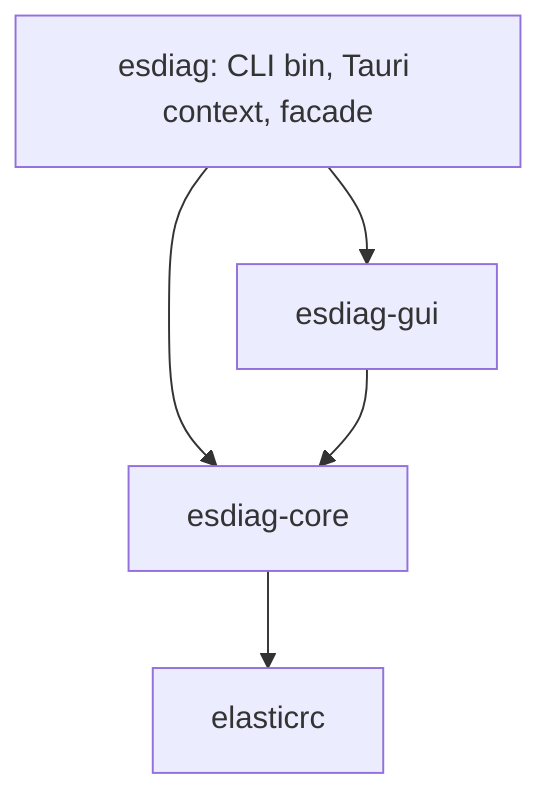

## Context

See proposal.md for motivation. Current state that shapes the approach:

- One package, `esdiag`, with a library (`src/lib.rs`) and the `esdiag` binary (`src/main.rs`, 6,163 lines, plus `src/local.rs` and `src/local/`). Baseline: an incremental `cargo build` after touching a processor file takes about 17s with `debug = "line-tables-only"`.
- `src/server/` (about 15k lines) depends on `data`, `job`, `setup`, `processor`, `exporter`, `onboarding`, and `embeds`. No library module outside `src/server/` depends on it; only `main.rs` does.
- Server unit tests use `crate::TestEnv` and `crate::es_mock` 43 times. Both are defined in `src/lib.rs` under `#[cfg(test)]`, which other crates cannot see.
- `src/embeds.rs` defines `Assets` (`assets/`, used by setup), `EsdiagSkillAssets` (`.agents/skills/esdiag/`, `agent` feature), `KIBANA_ASSETS_BUNDLE` (built by the root `build.rs` into `OUT_DIR`), `DocsAssets` (`docs/`, `server` feature), and `ServerAssets` (`src/server/assets/`). The catalog in `processor/diagnostic/data_source.rs` uses `include_str!("../../../assets/<product>/sources.yml")`. Askama resolves `templates/` relative to the package manifest.
- The Tauri wrapper is the no-subcommand branch of `main.rs` (about 90 lines): it builds a `tauri::Builder` with the opener plugin, starts `Server::start([127, 0, 0, 1], 0, ...)` in `setup`, navigates the `main` window to the bound URL, and shuts the server down when windows are destroyed. It ends with `.run(tauri::generate_context!())`. `desktop_startup_tests` in `main.rs` cover the embedded server start and ephemeral port.
- The root `build.rs` runs `tauri_build::try_build` under `desktop` with `tauri.conf.json` and `desktop/` (capabilities, frontend-dist, icons, packaging). `cargo tauri build --features desktop` runs from the repository root in `.github/workflows/desktop-artifacts.yml`, `desktop/scripts/`, and `docs/build/desktop-packaging.md`.
- Feature gates in the server: `keystore` (76 sites), `setup` (8), `desktop` (8), `elasticrc` (1). The library has `elasticrc`, `keystore`, `server` (the `all(server, keystore)` unlock-lease helpers), and `setup` gates.
- `esdiag` is on crates.io (0.17.2); `cargo install esdiag` is documented. Its package today contains the whole repository tree. `crates/repo-tools` depends on `esdiag` with `default-features = false` for the data-source catalog.
- Cargo rejects cyclic package dependencies even when only a binary target needs the other package (confirmed with a throwaway two-package workspace: `error: cyclic package dependency`).

## Goals / Non-Goals

**Goals:**

- Server, template, and desktop-wrapper edits stop recompiling the core library.
- The desktop build and bundling flow stays as it is.
- `cargo install esdiag` keeps working from crates.io.
- Decisions about further splits are made from measured timings.

**Non-Goals:**

- Splitting `esdiag-core` further.
- Changing any trait, typestate, or behavior. Code moves; visibility widens only where the crate boundary requires it.

## Decisions

### Three packages, not two

The binary must call the server and the desktop wrapper, so `esdiag` depends on `esdiag-gui`; `esdiag-gui` depends on the library. If the library stayed in the `esdiag` package, that would be a package cycle. The library therefore moves to `esdiag-core`.

| Package | Location | Contents |
|---|---|---|
| `esdiag-core` | `crates/esdiag-core/` | Everything in `src/` except `main.rs`, `local.rs`, `local/`, and `server/`; `Assets`, `EsdiagSkillAssets`, `KIBANA_ASSETS_BUNDLE` and its build step; `TestEnv` behind a `test-support` feature; the Elasticsearch mock, test-only, which `tests/common/` includes by path |
| `esdiag-gui` | `crates/esdiag-gui/` | `src/server/` (including `server/assets/`), `templates/`, `DocsAssets`, `ServerAssets`, the Tauri wrapper in a `desktop` module |
| `esdiag` | repository root | `main.rs`, `local.rs`, `local/`, facade `lib.rs`, `build.rs` (Windows stack args, NOTICE/SBOM, Tauri context), `tauri.conf.json`, `desktop/`, `tests/` |

Alternatives considered:

- Keep the library at the repository root, renamed to `esdiag-core`, and move the binary to `crates/esdiag/`. Core would keep its embedded files inside its package directory, but `tauri.conf.json`, `desktop/`, the desktop workflow and scripts, and the 19 test files that use `CARGO_BIN_EXE_esdiag` would all have to move with the binary.
- Invert the dependency so `esdiag-gui` does not depend on the library. Rejected: the server uses `data`, `job`, `setup`, `processor`, and `exporter` in over 100 places.

### Tauri wrapper in `esdiag-gui`, context generation in the binary

`esdiag_gui::desktop::run(context: tauri::Context<tauri::Wry>)` contains today's builder, plugin, server lifecycle, and window logic. The root `main.rs` calls `esdiag_gui::desktop::run(tauri::generate_context!())` in the no-subcommand branch under `all(feature = "server", feature = "desktop")`. `desktop_startup_tests` move to `esdiag-gui`.

`tauri::generate_context!()` must expand in the crate whose build script ran `tauri_build`, and the Tauri CLI builds and bundles the binary of the package that owns `tauri.conf.json`. Keeping `tauri.conf.json`, `desktop/`, and `tauri-build` with the binary leaves `cargo tauri build --features desktop`, the desktop workflow, and the desktop scripts unchanged.

Alternative considered: move `tauri.conf.json` and `desktop/` into `esdiag-gui`. Rejected: the Tauri CLI would then try to bundle an `esdiag-gui` binary, which does not exist.

### Feature mapping

| Root feature | Enables |
|---|---|
| `server` | `dep:esdiag-gui`, `esdiag-core/server` |
| `setup` | `esdiag-core/setup`, `esdiag-gui?/setup` |
| `agent` | `esdiag-core/agent` |
| `keystore` | `esdiag-core/keystore`, `esdiag-gui?/keystore` |
| `elasticrc` | `esdiag-core/elasticrc`, `esdiag-gui?/elasticrc` |
| `desktop` | `server`, `esdiag-gui/desktop`, `dep:tauri`, `dep:tauri-plugin-opener`, `dep:tauri-build` |

`esdiag-gui/desktop` enables `tauri` and `tauri-plugin-opener` and the 8 existing `desktop` sites in the server. `esdiag-gui` depends on `esdiag-core` with `features = ["server"]`. `elasticrc` and `dotenvy` move to `esdiag-core`, whose `setup` feature enables them; the root package no longer uses them directly.

The root package also depends directly on `tauri-plugin-opener` under `desktop`: `tauri_build` reads plugin permissions only from the direct dependencies of the package whose build script runs it, and fails on `opener:default` in the capability file otherwise.

The workspace sets `default-members` to the root and `esdiag-core`, so a plain `cargo test` from the repository root still runs the core unit tests. `esdiag-gui` stays out of `default-members` because a root `cargo build --no-default-features` would otherwise compile it; its unit tests run with `cargo test --workspace` or `cargo test -p esdiag-gui`.

`pub(crate)` items the server uses from the library (for example `get_active_unlock_keystore_password`, `list_secret_entries`, `ElasticContextTarget`, `write_hosts_yml_for_tests`) become `pub`; test-only ones move behind `esdiag-core/test-support`, which `esdiag-gui` enables only in `[dev-dependencies]`.

### Facade

The root `lib.rs` becomes `pub use esdiag_core::*;` plus `#[cfg(feature = "server")] pub use esdiag_gui::server;`, so `esdiag::data`, `esdiag::server`, and the other paths used by `main.rs`, `local.rs`, and `tests/` keep resolving. `crates/repo-tools` switches to `esdiag-core` directly.

### Lockstep versioning and publication

- `[workspace.package]` declares `version`, `edition`, `rust-version`, `license`, `repository`, and `homepage`; `esdiag`, `esdiag-core`, and `esdiag-gui` inherit them. `elasticrc` keeps its own version and Apache-2.0 license; `repo-tools` stays `publish = false`.
- `[workspace.dependencies]` declares `esdiag-core` and `esdiag-gui` as `{ path = "...", version = "=<workspace version>" }`, plus third-party dependencies shared by two or more packages.
- `cargo publish --workspace --exclude elasticrc --exclude repo-tools` publishes `esdiag-core`, `esdiag-gui`, and `esdiag` in dependency order. Multi-package publishing needs Cargo 1.90 or newer; release and CI publish jobs use stable while the build MSRV stays 1.89.
- `desktop/scripts/normalize-cargo-version-for-msi.sh` rewrites the `[workspace.package]` version and the matching exact `=` requirements together, since the root `[package]` now inherits its version.
- The release skill gains the workspace version and exact `=` requirements as version surfaces, the asset sync step, the three-package dry run, and recovery from a partial publish (publish the remaining packages at the same version; never re-publish).

Alternative considered: caret requirements between the three packages. Rejected: with no API stability promised, a newer patch of one crate could break an older `esdiag`.

### Self-contained packages

A published package contains only files under its own directory.

| Package | Canonical source | Bundled path |
|---|---|---|
| `esdiag-core` | `assets/` (including `<product>/sources.yml` and `kibana/`), `.agents/skills/esdiag/` (`SKILL.md`, `references/`, `agents/`), `LICENSE.txt` | `bundled/assets/`, `bundled/skill/`, `bundled/license/` |
| `esdiag-gui` | `docs/`, `LICENSE.txt` | `bundled/docs/`, `bundled/license/` |

- `bin/sync-crate-assets.sh` copies these into each crate's gitignored `bundled/` directory and supports `--check`, following `bin/sync-plugin-skill.sh`. Each crate lists `bundled/**` in `package.include`.
- Cargo counts included files that Git does not track as uncommitted changes, so packaging commands pass `--allow-dirty`, guarded by `test -z "$(git status --porcelain)"`, which ignores `bundled/` but catches every other uncommitted change.
- Each crate's build script selects the asset root: the canonical repository path when it exists and the crate is not packaged, otherwise `bundled/`. Cargo writes `.cargo_vcs_info.json` only into packaged crates, which marks the packaged case. The root is exported with `cargo:rustc-env`, and code reads it through `include_str!(concat!(env!(...), ...))` and `rust-embed` folders using `interpolate-folder-path`. A packaged build with a missing `bundled/` fails with a message naming the sync script.
- `templates/` moves to `crates/esdiag-gui/templates/`, because Askama resolves template directories relative to the manifest. `src/server/assets/` moves with the server code.
- The Kibana assets zip build moves from the root `build.rs` to `esdiag-core`'s build script under its `setup` feature.
- The root package gains a `package.include` list for what it compiles and embeds (`src/`, `build.rs`, `tauri.conf.json`, `desktop/`, license and notice files).

Alternatives considered: moving canonical files into the crates (rewrites `assets/<product>/sources.yml` paths named in 8 specs, ADRs, and scripts; `docs/` and the skill cannot move), and committing the bundled copies (doubles every asset diff).

### Build-timing script and gates

`bin/build-timings.sh` (Bash) measures incremental debug builds on the current host:

| Scenario | File touched | Command |
|---|---|---|
| `server` | a web server source file | `cargo build` |
| `core` | a processor source file | `cargo build` |
| `cli` | `src/main.rs` | `cargo build` |
| `server-tests` | a web server source file | `cargo test --no-run` |
| `clean` | none, after `cargo clean -p` for the workspace packages | `cargo build` |

For each scenario it warms the build once, then runs three times, updating the file's modification time with `touch` before each run, and prints the median in seconds. It accepts a `--runs N` override and takes the file paths from arguments with defaults for the current layout, so the same script measures the baseline commit and the split.

The baseline is measured on the commit before the split, on the same host as the post-split measurement. The PR description records both tables. The gates are in the spec. The 30% server target is conservative against the expected drop from about 76k to about 24k recompiled lines; a miss means the split is not worth its release cost, and the change should be revisited rather than merged.

## Risks / Trade-offs

- [Core edits, which are the majority of commits, still rebuild everything and may get slightly slower from the extra crate boundary] → Gated at no more than 10% slower; further splits of core are held until this change's timings are known.
- [Every release publishes three packages; a failure partway leaves a partial set] → `cargo publish --workspace` verifies all packages before uploading; the release skill documents finishing a partial publish.
- [Bundled assets drift from canonical ones] → Packaging runs the sync first, and CI runs `--check` in the publish dry-run job.
- [`package.include` leaves out a needed file] → The multi-package publish dry run builds each package from its tarball.
- [Timing is noisy across hosts and runs] → Same-host comparison, warm-up run, median of three, and thresholds well outside typical run-to-run noise (about 3% observed for the baseline).
- [Log lines name their module path, which changes from `esdiag::…` to `esdiag_core::…` and `esdiag_gui::server::…`] → Filters are level-only (`LOG_LEVEL` and `--debug` set a level, not a target), so only the displayed target text changes; noted in the PR.
- [Facade re-exports keep old paths alive] → The facade serves `main.rs`, `local.rs`, and `tests/`; new code imports `esdiag-core` or `esdiag-gui` directly.

## Migration Plan

1. Add `bin/build-timings.sh` and record the baseline on the pre-split commit.
2. Add `[workspace.package]` and `[workspace.dependencies]`.
3. Move the library to `crates/esdiag-core/` with `test-support` and the asset-root build script; add `bin/sync-crate-assets.sh`; turn the root `lib.rs` into the facade; point `repo-tools` at `esdiag-core`.
4. Move the server, templates, and Tauri wrapper to `crates/esdiag-gui/`; wire root features.
5. Measure timings against the gates; stop and revisit if the server gate fails.
6. Add exact version requirements, implementation-crate descriptions and READMEs, the root `package.include`, CI for layering, asset sync, and the publish dry run; update the release skill and repository docs.

Rollback is a revert. After the first release that publishes `esdiag-core` and `esdiag-gui`, those names and versions on crates.io are permanent.
